# 02 · Database entity-relationship diagrams

**Date:** 2026-11-27 · Source: the canonical inventory in [`01_database_design.md`](01_database_design.md) §3. Column-level detail is in §4 of that document. If a diagram and `01` disagree, `01` wins.

## Legend

- Entity names are written `schema_table`, because Mermaid does not allow dots in names. For example, `practice_attempt_answers` is `practice.attempt_answers`.
- Attributes are limited to keys and the columns that carry relations. `PK` means primary key, `FK` foreign key, and `UK` a unique key.
- Cardinality uses Mermaid crow's foot notation:
  - `||--o{` one to zero-or-many
  - `||--|{` one to one-or-many
  - `||--o|` one to zero-or-one
  - `}o--o{` many to many, through a join table
- Each per-schema diagram shows tables from other schemas as **stub entities**, marked by a `%% cross-schema` comment. A relation drawn to a stub is a real foreign key only if §1.1 of `01` allows one; otherwise it is a soft reference, validated through the owning module's interface.
- `(P)` in the relationship label of a high-volume edge means the child table is partitioned. Partitioned tables are never the target of a foreign key.
- The build that creates each table is given in `01` §3. Most diagrams show the full P0 to P2 design.

## 1. Cross-schema FKs allowed (`01` §1.1)

| From (examples) | To | Rule |
|---|---|---|
| Every schema: `*.user_id`, `created_by`, `actor_id` (except the two hot tables below) | `identity.users(id)` | Allowed. Users are anonymised, never hard-deleted. |
| `practice.session_items`, `exam.exam_paper_items`, `ai.canonical_answers`, `cms.*`, `institution.written_task_items`, `qbank.paper_items` | `qbank.question_versions(id)` | Allowed (immutable rows). |
| `practice.attempt_answers`, `rewards.reward_transactions` | `identity.users`, `qbank.question_versions`, `identity.track_enrolments` | **No FKs** (01 §1.1 exception, R-14). These are the hottest insert paths, and FK `KEY SHARE` locks on a few hot parents cause MultiXact contention; dropping the FKs also keeps the separate-cluster option. References are validated in the application, plus a nightly orphan check. In the diagrams these edges are soft references. |
| `practice.bookmarks`, `practice.mistake_entries`, `community.threads`, `cms.error_reports` | `qbank.questions(id)` | Allowed. |
| `identity.track_enrolments`, `commerce.products`, `exam.blueprints`, `notify.tracker_items` | `curriculum.tracks`, `curriculum.syllabus_versions` | Allowed. |
| `analytics.topic_progress`, `qbank.question_node_map`, `exam.blueprint_rules`, `ai.content_chunks` | `curriculum.taxonomy_nodes(id)` | Allowed. |
| `identity.profiles`, `institution.workspaces`, `rewards.team_scores` | `identity.institutions`, `identity.districts` | Allowed. |
| Any table | `practice.attempt_answers`, `rewards.reward_transactions`, `ai.tutor_messages`, `exam.exam_answer_batches`, `platform.outbox` | **Not allowed.** These are partitioned or high-volume. References are plain `uuid` columns. |
| Any table | another module's mutable rows (e.g. `commerce.entitlements`, `exam.exam_attempts`) | **Not allowed.** Soft reference, checked through the owning module's interface. |

## 2. Overview: main aggregates across schemas

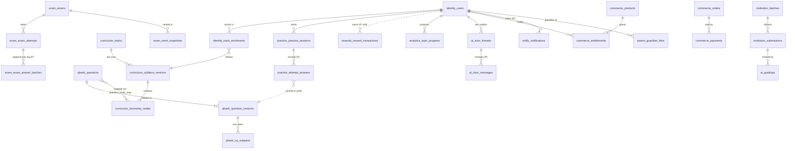

## 3. `platform` (NFR)

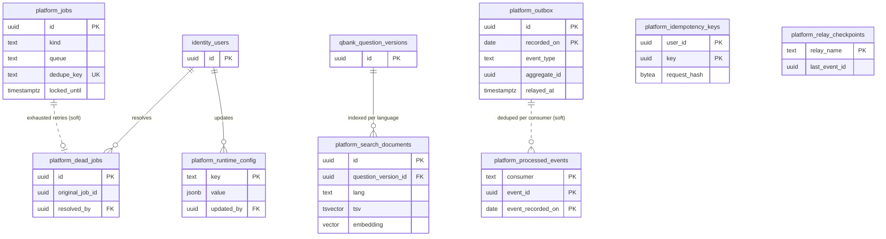

## 4. `identity` (AUTH)

```mermaid
erDiagram
  %% cross-schema stubs
  curriculum_tracks {
    uuid id PK
  }
  curriculum_syllabus_versions {
    uuid id PK
  }
  curriculum_boards {
    text code PK
  }
  identity_users {
    uuid id PK
    bytea phone_hash UK
    bytea email_hash UK
    text status
  }
  identity_external_identities {
    uuid id PK
    uuid user_id FK
    text provider
    text provider_subject
  }
  identity_otp_challenges {
    uuid id PK
    bytea phone_hash
    text purpose
  }
  identity_device_sessions {
    uuid id PK
    uuid user_id FK
    int exam_epoch
  }
  identity_refresh_tokens {
    uuid id PK
    uuid session_id FK
    uuid family_id
    bytea token_hash UK
  }
  identity_roles {
    text code PK
  }
  identity_permissions {
    text code PK
  }
  identity_role_permissions {
    text role_code PK
    text permission_code PK
  }
  identity_role_grants {
    uuid id PK
    uuid user_id FK
    text role_code FK
    text scope_type
    uuid scope_id
  }
  identity_profiles {
    uuid user_id PK
    uuid institution_id FK
    smallint district_id FK
    text board_code FK
  }
  identity_districts {
    smallint id PK
  }
  identity_upazilas {
    int id PK
    smallint district_id FK
  }
  identity_institutions {
    uuid id PK
    text eiin UK
    smallint district_id FK
  }
  identity_track_enrolments {
    uuid id PK
    uuid user_id FK
    uuid track_id FK
    uuid syllabus_version_id FK
    uuid promoted_from_id FK
  }
  identity_consent_documents {
    text version PK
    text lang PK
  }
  identity_guardian_consents {
    uuid id PK
    uuid user_id FK
    uuid otp_challenge_id FK
    text consent_version
  }
  identity_privacy_settings {
    uuid user_id PK
  }
  identity_data_requests {
    uuid id PK
    uuid user_id FK
  }
  identity_device_profile_links {
    text device_id PK
    uuid user_id PK
  }
  identity_password_credentials {
    uuid user_id PK
  }
  identity_email_verifications {
    uuid id PK
    uuid user_id FK
  }
  identity_apple_notifications {
    uuid id PK
    text event_id UK
  }
  identity_users ||--o{ identity_external_identities : "signs in with"
  identity_users ||--o{ identity_device_sessions : has
  identity_device_sessions ||--o{ identity_refresh_tokens : rotates
  identity_refresh_tokens ||--o| identity_refresh_tokens : "parent of"
  identity_roles ||--o{ identity_role_permissions : maps
  identity_permissions ||--o{ identity_role_permissions : maps
  identity_users ||--o{ identity_role_grants : granted
  identity_roles ||--o{ identity_role_grants : "granted as"
  identity_users ||--|| identity_profiles : "has profile"
  identity_users ||--|| identity_privacy_settings : "has settings"
  identity_districts ||--o{ identity_upazilas : contains
  identity_districts ||--o{ identity_institutions : "located in"
  identity_institutions ||--o{ identity_profiles : "self-reported"
  identity_districts ||--o{ identity_profiles : "lives in"
  curriculum_boards ||--o{ identity_profiles : "board of"
  identity_users ||--o{ identity_track_enrolments : enrols
  curriculum_tracks ||--o{ identity_track_enrolments : "track of"
  curriculum_syllabus_versions ||--o{ identity_track_enrolments : follows
  identity_track_enrolments ||--o| identity_track_enrolments : "promoted to"
  identity_users ||--o{ identity_guardian_consents : "consent for"
  identity_otp_challenges ||--o| identity_guardian_consents : confirms
  identity_consent_documents ||--o{ identity_guardian_consents : "wording"
  identity_users ||--o{ identity_data_requests : requests
  identity_users ||--o{ identity_device_profile_links : "on shared device"
  identity_users ||--o| identity_password_credentials : "password"
  identity_users ||--o{ identity_email_verifications : verifies
  identity_external_identities ||..o{ identity_apple_notifications : "about (soft)"
```

## 5. `community` (COM)

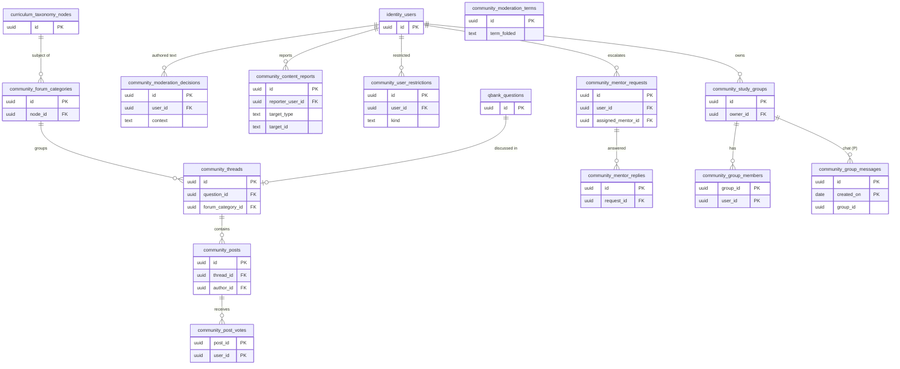

## 6. `notify` (PLAN)

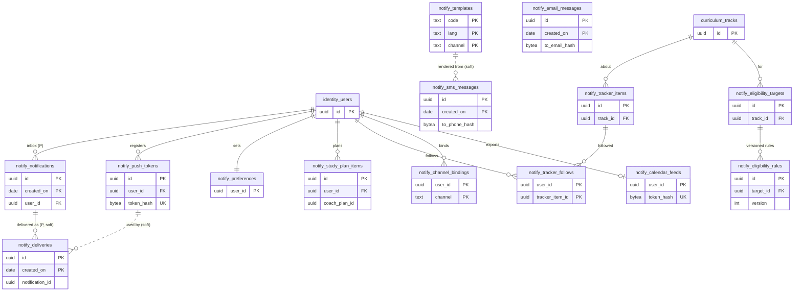

## 7. `ops` (OPS)

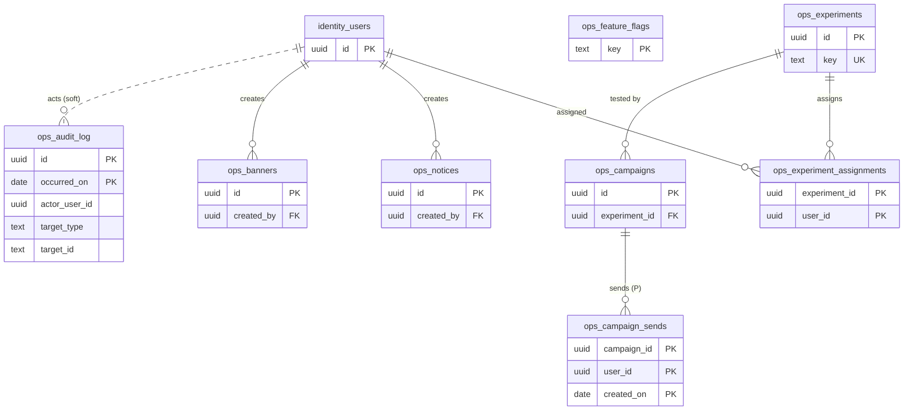

## 8. `curriculum` (TAX)

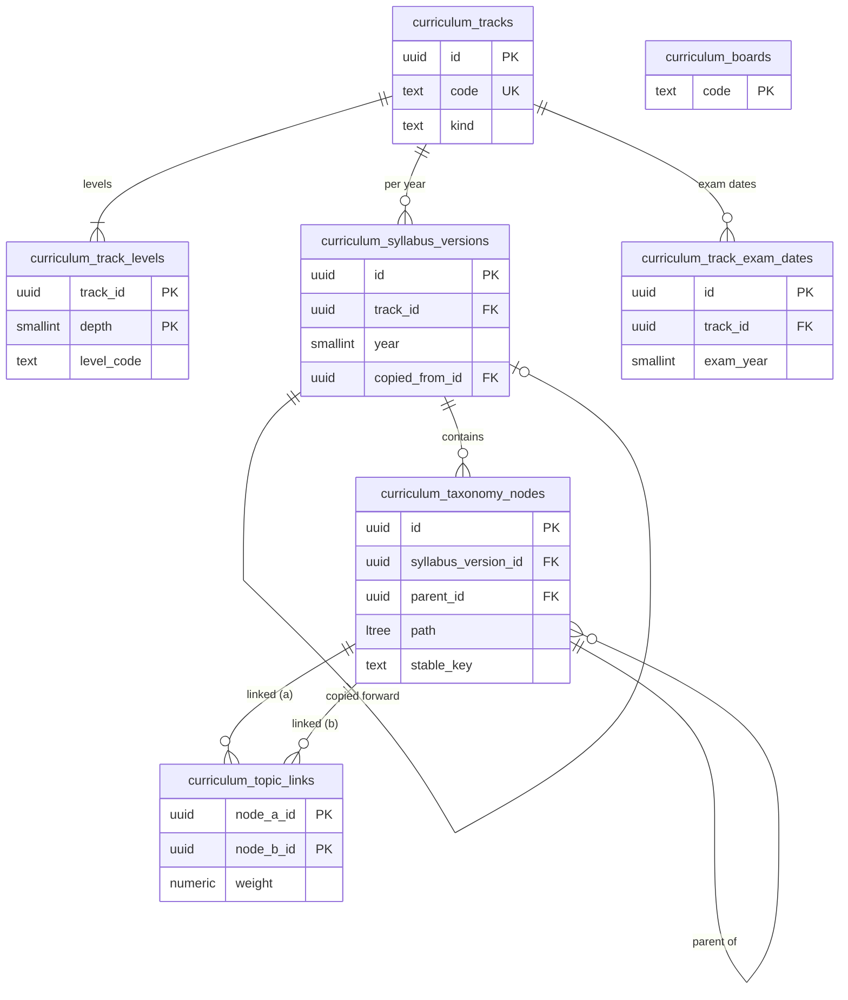

## 9. `qbank` (QB)

```mermaid
erDiagram
  %% cross-schema stubs
  curriculum_taxonomy_nodes {
    uuid id PK
  }
  curriculum_tracks {
    uuid id PK
  }
  curriculum_boards {
    text code PK
  }
  qbank_questions {
    uuid id PK
    text type
    uuid tenant_id
    uuid family_id FK
    text source_rights
    uuid current_version_id FK
  }
  qbank_question_versions {
    uuid id PK
    uuid question_id FK
    int version_no
    uuid supersedes_id FK
    uuid concept_note_id FK
  }
  qbank_qv_content {
    uuid question_version_id PK
    text lang PK
  }
  qbank_cq_subparts {
    uuid id PK
    uuid question_version_id FK
    smallint ordinal
  }
  qbank_rubric_points {
    uuid id PK
    uuid subpart_id FK
  }
  qbank_question_node_map {
    uuid question_id PK
    uuid node_id PK
  }
  qbank_question_media {
    uuid id PK
    uuid question_version_id FK
  }
  qbank_papers {
    uuid id PK
    text board_code FK
    smallint year
  }
  qbank_paper_items {
    uuid paper_id PK
    smallint position PK
    uuid question_version_id FK
  }
  qbank_paper_tracks {
    uuid paper_id PK
    uuid track_id PK
  }
  qbank_concept_notes {
    uuid id PK
    uuid node_id FK
  }
  qbank_import_jobs {
    uuid id PK
    text source_rights
  }
  qbank_import_rows {
    uuid id PK
    uuid import_job_id FK
    uuid question_id FK
  }
  qbank_import_pages {
    uuid id PK
    uuid import_job_id FK
  }
  qbank_question_fingerprints {
    uuid question_version_id PK
    bytea text_hash
  }
  qbank_duplicate_candidates {
    uuid id PK
    uuid question_id FK
    uuid candidate_question_id FK
  }
  qbank_rendering_failures {
    uuid id PK
    uuid question_version_id FK
  }
  qbank_question_families {
    uuid id PK
    uuid concept_node_id FK
  }
  qbank_item_statistics {
    uuid question_version_id PK
    text window_code PK
  }
  qbank_flashcard_decks {
    uuid id PK
    uuid node_id FK
  }
  qbank_flashcards {
    uuid id PK
    uuid deck_id FK
  }
  qbank_current_affairs_items {
    uuid id PK
    date item_date
  }
  qbank_current_affairs_compilations {
    uuid id PK
    date month UK
  }
  qbank_item_flags {
    uuid id PK
    uuid question_version_id FK
  }
  qbank_questions ||--|{ qbank_question_versions : "edited as"
  qbank_question_versions ||--o| qbank_question_versions : supersedes
  qbank_question_versions ||--|{ qbank_qv_content : "bn and en"
  qbank_question_versions ||--o{ qbank_cq_subparts : "CQ parts"
  qbank_cq_subparts ||--o{ qbank_rubric_points : "marked by"
  qbank_questions ||--o{ qbank_question_node_map : "mapped"
  curriculum_taxonomy_nodes ||--o{ qbank_question_node_map : "contains"
  qbank_question_versions ||--o{ qbank_question_media : media
  curriculum_boards ||--o{ qbank_papers : "board of"
  qbank_papers ||--|{ qbank_paper_items : includes
  qbank_question_versions ||--o{ qbank_paper_items : "pinned in"
  qbank_papers ||--o{ qbank_paper_tracks : "shared by"
  curriculum_tracks ||--o{ qbank_paper_tracks : "uses"
  curriculum_taxonomy_nodes ||--o{ qbank_concept_notes : "notes for"
  qbank_concept_notes ||--o{ qbank_question_versions : "linked from"
  qbank_import_jobs ||--o{ qbank_import_rows : "validates"
  qbank_import_jobs ||--o{ qbank_import_pages : "OCR pages"
  qbank_questions ||--o{ qbank_import_rows : "created from"
  qbank_question_versions ||--o| qbank_question_fingerprints : fingerprint
  qbank_questions ||--o{ qbank_duplicate_candidates : "possible duplicate"
  qbank_question_versions ||--o{ qbank_rendering_failures : "render errors"
  qbank_question_families ||--o{ qbank_questions : "variants"
  qbank_question_versions ||--o{ qbank_item_statistics : stats
  qbank_flashcard_decks ||--o{ qbank_flashcards : cards
  curriculum_taxonomy_nodes ||--o{ qbank_flashcard_decks : "deck for"
  qbank_question_versions ||--o{ qbank_item_flags : flagged
```

## 10. `cms` (CMS)

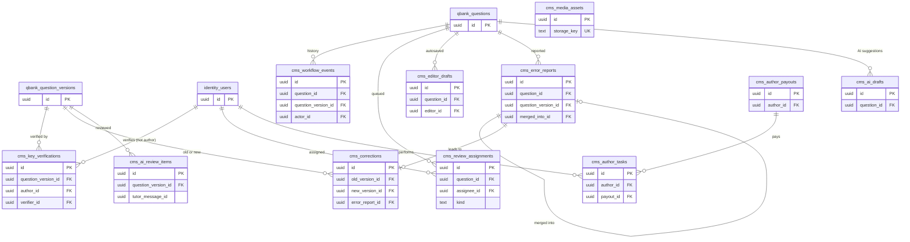

## 11. `practice` (PRAC)

```mermaid
erDiagram
  %% cross-schema stubs
  identity_users {
    uuid id PK
  }
  identity_track_enrolments {
    uuid id PK
  }
  qbank_questions {
    uuid id PK
  }
  qbank_question_versions {
    uuid id PK
  }
  cms_corrections {
    uuid id PK
  }
  practice_practice_sessions {
    uuid id PK
    uuid user_id FK
    uuid track_enrolment_id FK
    uuid client_session_id UK
  }
  practice_session_items {
    uuid session_id PK
    smallint position PK
    uuid question_version_id FK
  }
  practice_attempt_answers {
    uuid user_id PK
    uuid id PK
    uuid session_id
    uuid exam_attempt_id
    uuid question_version_id FK
    timestamptz effective_at
  }
  practice_score_adjustments {
    uuid id PK
    uuid user_id FK
    uuid answer_id
    uuid correction_id FK
  }
  practice_mistake_entries {
    uuid user_id PK
    uuid question_id PK
    text status
  }
  practice_bookmark_folders {
    uuid id PK
    uuid user_id FK
  }
  practice_bookmarks {
    uuid id PK
    uuid user_id FK
    uuid question_id FK
    uuid folder_id FK
  }
  practice_question_notes {
    uuid user_id PK
    uuid question_id PK
  }
  practice_ability_estimates {
    uuid user_id PK
    uuid node_id PK
  }
  practice_review_cards {
    uuid id PK
    uuid user_id FK
    uuid question_id FK
    uuid flashcard_id
  }
  practice_daily_mixes {
    uuid user_id PK
    uuid track_enrolment_id PK
    date dhaka_date PK
    uuid session_id FK
  }
  practice_offline_packs {
    uuid id PK
    uuid user_id FK
    uuid chapter_node_id FK
    uuid entitlement_id
    text status
  }
  practice_diagnostic_blueprints {
    uuid id PK
    uuid track_id FK
  }
  practice_duel_rooms {
    uuid id PK
    uuid host_user_id FK
  }
  practice_duel_participants {
    uuid room_id PK
    uuid user_id PK
  }
  practice_duel_rounds {
    uuid room_id PK
    int round_no PK
    uuid question_version_id FK
  }
  practice_duel_answers {
    uuid room_id PK
    int round_no PK
    uuid user_id PK
    uuid answer_id
  }
  identity_users ||--o{ practice_practice_sessions : starts
  identity_track_enrolments ||--o{ practice_practice_sessions : "within"
  practice_practice_sessions ||--|{ practice_session_items : "pins"
  qbank_question_versions ||--o{ practice_session_items : "selected"
  practice_practice_sessions ||..o{ practice_attempt_answers : "records (P, soft)"
  qbank_question_versions ||..o{ practice_attempt_answers : "pinned to (P, soft, no FK)"
  practice_attempt_answers ||--o{ practice_score_adjustments : "rescored (soft)"
  cms_corrections ||--o{ practice_score_adjustments : causes
  identity_users ||--o{ practice_mistake_entries : notebook
  qbank_questions ||--o{ practice_mistake_entries : "in notebook"
  identity_users ||--o{ practice_bookmark_folders : owns
  practice_bookmark_folders ||--o{ practice_bookmarks : holds
  qbank_questions ||--o{ practice_bookmarks : bookmarked
  qbank_questions ||--o{ practice_question_notes : "noted"
  identity_users ||--o{ practice_ability_estimates : ability
  identity_users ||--o{ practice_review_cards : reviews
  identity_users ||--o{ practice_offline_packs : "downloads"
  practice_practice_sessions ||--o| practice_daily_mixes : "served as"
  practice_duel_rooms ||--o{ practice_duel_participants : has
  practice_duel_rooms ||--o{ practice_duel_rounds : rounds
  practice_duel_rounds ||--o{ practice_duel_answers : answers
```

## 12. `exam` (EXAM)

```mermaid
erDiagram
  %% cross-schema stubs
  identity_users {
    uuid id PK
  }
  qbank_question_versions {
    uuid id PK
  }
  qbank_papers {
    uuid id PK
  }
  curriculum_taxonomy_nodes {
    uuid id PK
  }
  exam_blueprints {
    uuid id PK
    uuid syllabus_version_id FK
    uuid subject_node_id FK
  }
  exam_section_types {
    text code PK
  }
  exam_blueprint_sections {
    uuid id PK
    uuid blueprint_id FK
    text section_type FK
  }
  exam_blueprint_rules {
    uuid id PK
    uuid section_id FK
    uuid node_id FK
  }
  exam_exams {
    uuid id PK
    uuid blueprint_id FK
    uuid paper_id FK
    text kind
  }
  exam_exam_audiences {
    uuid exam_id PK
    text audience_type PK
    uuid audience_id PK
  }
  exam_exam_papers {
    uuid id PK
    uuid exam_id FK
    text lang
    text set_code
  }
  exam_exam_paper_items {
    uuid exam_paper_id PK
    smallint position PK
    uuid question_version_id FK
  }
  exam_registrations {
    uuid id PK
    uuid exam_id FK
    uuid user_id FK
  }
  exam_exam_attempts {
    uuid id PK
    uuid exam_id FK
    uuid user_id FK
    uuid registration_id FK
    int attempt_no
  }
  exam_exam_answer_batches {
    uuid attempt_id PK
    int seq PK
    date exam_starts_on PK
  }
  exam_exam_answers_latest {
    uuid attempt_id PK
    uuid question_version_id PK
    date exam_starts_on PK
    int seq
  }
  exam_scoring_configs {
    uuid id PK
    uuid exam_id FK
    int version
  }
  exam_exam_results {
    uuid attempt_id PK
    uuid exam_id FK
    text phase
  }
  exam_merit_snapshots {
    uuid id PK
    uuid exam_id FK
    int version
  }
  exam_merit_entries {
    uuid snapshot_id PK
    uuid attempt_id PK
  }
  exam_close_runs {
    uuid id PK
    uuid exam_id FK
    text phase
  }
  exam_incidents {
    uuid id PK
    uuid exam_id FK
  }
  exam_time_extensions {
    uuid id PK
    uuid exam_id FK
    uuid attempt_id FK
  }
  exam_late_answer_cases {
    uuid id PK
    uuid attempt_id FK
  }
  exam_integrity_events {
    uuid id PK
    date created_on PK
    uuid attempt_id
  }
  exam_anomaly_flags {
    uuid id PK
    uuid attempt_id FK
  }
  exam_written_answers {
    uuid id PK
    uuid attempt_id FK
  }
  exam_written_answer_pages {
    uuid id PK
    uuid written_answer_id FK
  }
  exam_series {
    uuid id PK
    uuid product_id
  }
  exam_series_items {
    uuid series_id PK
    uuid exam_id PK
  }
  exam_series_standings {
    uuid series_id PK
    uuid user_id PK
  }
  exam_certificates {
    uuid id PK
    uuid user_id FK
    text verify_code UK
  }
  exam_proctor_snapshots {
    uuid id PK
    uuid attempt_id FK
  }
  exam_cutoff_history {
    uuid id PK
  }
  exam_score_predictions {
    uuid id PK
    uuid user_id FK
  }
  exam_attempt_question_orders {
    uuid attempt_id PK
  }
  exam_paper_set_assignments {
    uuid exam_id PK
    uuid user_id PK
  }
  curriculum_taxonomy_nodes ||--o{ exam_blueprints : "subject of"
  exam_blueprints ||--|{ exam_blueprint_sections : sections
  exam_section_types ||--o{ exam_blueprint_sections : "typed as"
  exam_blueprint_sections ||--o{ exam_blueprint_rules : rules
  exam_blueprints ||--o{ exam_exams : "instantiated"
  qbank_papers ||--o{ exam_exams : "past paper"
  exam_exams ||--o{ exam_exam_audiences : "restricted to"
  exam_exams ||--|{ exam_exam_papers : "bundles per language"
  exam_exam_papers ||--|{ exam_exam_paper_items : items
  qbank_question_versions ||--o{ exam_exam_paper_items : "pinned"
  exam_exams ||--o{ exam_registrations : "registered"
  identity_users ||--o{ exam_registrations : registers
  exam_registrations ||--o{ exam_exam_attempts : "attempts"
  exam_exam_attempts ||--o{ exam_exam_answer_batches : "log (P)"
  exam_exam_attempts ||--o{ exam_exam_answers_latest : "latest (P)"
  exam_exams ||--o{ exam_scoring_configs : versions
  exam_exam_attempts ||--o| exam_exam_results : scored
  exam_exams ||--o{ exam_merit_snapshots : ranked
  exam_merit_snapshots ||--|{ exam_merit_entries : entries
  exam_exams ||--o{ exam_close_runs : "close phases"
  exam_exams ||--o{ exam_incidents : incidents
  exam_exams ||--o{ exam_time_extensions : extended
  exam_exam_attempts ||--o{ exam_late_answer_cases : "late answers"
  exam_exam_attempts ||--o{ exam_integrity_events : "integrity (P, soft)"
  exam_exam_attempts ||--o{ exam_anomaly_flags : flagged
  exam_exam_attempts ||--o{ exam_written_answers : "written"
  exam_written_answers ||--o{ exam_written_answer_pages : pages
  exam_series ||--|{ exam_series_items : contains
  exam_exams ||--o{ exam_series_items : "in series"
  exam_series ||--o{ exam_series_standings : standings
  identity_users ||--o{ exam_certificates : earns
  exam_exam_attempts ||--o{ exam_proctor_snapshots : proctored
  identity_users ||--o{ exam_score_predictions : predicted
  exam_exam_attempts ||--o| exam_attempt_question_orders : "shuffle"
  exam_exams ||--o{ exam_paper_set_assignments : "set per user"
```

## 13. `analytics` (ANL)

```mermaid
erDiagram
  %% cross-schema stubs
  identity_users {
    uuid id PK
  }
  identity_track_enrolments {
    uuid id PK
  }
  curriculum_taxonomy_nodes {
    uuid id PK
  }
  analytics_topic_progress {
    uuid user_id PK
    uuid track_enrolment_id PK
    uuid node_id PK
  }
  analytics_daily_study {
    uuid user_id PK
    uuid track_enrolment_id PK
    date dhaka_date PK
  }
  analytics_projection_versions {
    text projection PK
    int version PK
  }
  analytics_rebuild_audits {
    uuid id PK
  }
  analytics_mastery_state {
    uuid user_id PK
    uuid node_id PK
  }
  analytics_time_analytics {
    uuid user_id PK
    uuid track_enrolment_id PK
    text period_key PK
  }
  analytics_trend_snapshots {
    uuid syllabus_version_id PK
    uuid node_id PK
    text source_kind PK
  }
  analytics_peer_percentiles {
    uuid track_id PK
    smallint exam_year PK
    smallint district_id PK
    text metric PK
    date computed_on PK
  }
  analytics_readiness_forecasts {
    uuid user_id PK
    uuid track_enrolment_id PK
  }
  analytics_report_exports {
    uuid id PK
    uuid subject_user_id FK
  }
  identity_users ||--o{ analytics_topic_progress : progress
  identity_track_enrolments ||--o{ analytics_topic_progress : "per enrolment"
  curriculum_taxonomy_nodes ||--o{ analytics_topic_progress : "per node"
  identity_users ||--o{ analytics_daily_study : "study days"
  identity_users ||--o{ analytics_mastery_state : mastery
  curriculum_taxonomy_nodes ||--o{ analytics_mastery_state : "per topic"
  identity_users ||--o{ analytics_time_analytics : "time patterns"
  curriculum_taxonomy_nodes ||--o{ analytics_trend_snapshots : trends
  identity_track_enrolments ||--o| analytics_readiness_forecasts : forecast
  identity_users ||--o{ analytics_report_exports : "reported on"
  analytics_projection_versions ||..o{ analytics_topic_progress : "version stamp (soft)"
```

## 14. `ai` (AI)

```mermaid
erDiagram
  %% cross-schema stubs
  identity_users {
    uuid id PK
  }
  qbank_question_versions {
    uuid id PK
  }
  qbank_rubric_points {
    uuid id PK
  }
  curriculum_taxonomy_nodes {
    uuid id PK
  }
  institution_submissions {
    uuid id PK
  }
  ai_tutor_threads {
    uuid id PK
    uuid user_id FK
    uuid subject_node_id FK
  }
  ai_tutor_messages {
    uuid id PK
    date created_on PK
    uuid thread_id
  }
  ai_tutor_citations {
    uuid message_id PK
    smallint ordinal PK
    date created_on PK
    uuid chunk_id
    uuid question_version_id
  }
  ai_ai_usage {
    uuid id PK
    date created_on PK
    uuid user_id
  }
  ai_canonical_answers {
    uuid id PK
    uuid question_version_id FK
    text action
    text prompt_version
  }
  ai_content_sources {
    uuid id PK
    text licence_status
  }
  ai_content_chunks {
    uuid id PK
    uuid source_id FK
    uuid chapter_node_id FK
    vector embedding
  }
  ai_prompt_versions {
    text id PK
    uuid eval_run_id FK
  }
  ai_eval_sets {
    uuid id PK
  }
  ai_eval_runs {
    uuid id PK
    uuid eval_set_id FK
  }
  ai_eval_results {
    uuid run_id PK
    text item_id PK
  }
  ai_feedback {
    uuid id PK
    uuid message_id
    uuid user_id FK
  }
  ai_photo_solves {
    uuid id PK
    uuid user_id FK
    uuid thread_id FK
    uuid match_question_version_id FK
  }
  ai_pending_questions {
    uuid id PK
    uuid message_id
  }
  ai_cost_budgets {
    date dhaka_date PK
  }
  ai_marking_jobs {
    uuid id PK
    uuid submission_id UK
  }
  ai_gradings {
    uuid id PK
    uuid submission_ref_id
    text source
    uuid supersedes_id FK
  }
  ai_grading_parts {
    uuid id PK
    uuid grading_id FK
    uuid rubric_point_id FK
  }
  ai_accuracy_reports {
    uuid id PK
    uuid subject_node_id FK
  }
  ai_ai_items {
    uuid id PK
    uuid user_id FK
  }
  ai_ai_quizzes {
    uuid id PK
    uuid user_id FK
  }
  ai_chapter_summaries {
    uuid id PK
    uuid chapter_node_id FK
  }
  ai_coach_plans {
    uuid id PK
    uuid user_id FK
  }
  ai_misconception_clusters {
    uuid id PK
    uuid user_id FK
  }
  ai_voice_sessions {
    uuid id PK
    uuid user_id FK
    uuid scenario_id FK
  }
  ai_voice_turns {
    uuid session_id PK
    int turn_no PK
    text transcript
  }
  ai_viva_scenarios {
    uuid id PK
  }
  ai_voice_sessions ||--o{ ai_voice_turns : "has turns"
  identity_users ||--o{ ai_tutor_threads : "chats"
  curriculum_taxonomy_nodes ||--o{ ai_tutor_threads : "subject"
  ai_tutor_threads ||--o{ ai_tutor_messages : "contains (P, soft)"
  ai_tutor_messages ||--o{ ai_tutor_citations : "cites (P)"
  ai_content_chunks ||..o{ ai_tutor_citations : "cited (soft)"
  ai_tutor_messages ||..o{ ai_ai_usage : "costed (P, soft)"
  qbank_question_versions ||--o{ ai_canonical_answers : "explained"
  ai_content_sources ||--o{ ai_content_chunks : chunks
  curriculum_taxonomy_nodes ||--o{ ai_content_chunks : "chapter"
  ai_eval_sets ||--o{ ai_eval_runs : runs
  ai_eval_runs ||--o{ ai_eval_results : results
  ai_eval_runs ||--o{ ai_prompt_versions : "gates"
  identity_users ||--o{ ai_feedback : rates
  identity_users ||--o{ ai_photo_solves : photographs
  ai_tutor_threads ||--o{ ai_photo_solves : "in thread"
  ai_tutor_messages ||..o| ai_pending_questions : "queued (soft)"
  institution_submissions ||--o| ai_marking_jobs : "drafted by"
  institution_submissions ||..o{ ai_gradings : "graded (soft)"
  ai_gradings ||--o| ai_gradings : supersedes
  ai_gradings ||--|{ ai_grading_parts : parts
  qbank_rubric_points ||--o{ ai_grading_parts : "per point"
  curriculum_taxonomy_nodes ||--o{ ai_accuracy_reports : "per subject"
  identity_users ||--o{ ai_ai_items : generates
  identity_users ||--o{ ai_ai_quizzes : takes
  curriculum_taxonomy_nodes ||--o{ ai_chapter_summaries : summarised
  identity_users ||--o{ ai_coach_plans : coached
  identity_users ||--o{ ai_misconception_clusters : diagnosed
  ai_viva_scenarios ||--o{ ai_voice_sessions : "scenario"
  identity_users ||--o{ ai_voice_sessions : speaks
```

## 15. `rewards` (GAM)

```mermaid
erDiagram
  %% cross-schema stubs
  identity_users {
    uuid id PK
  }
  identity_institutions {
    uuid id PK
  }
  rewards_reward_rules {
    int version PK
  }
  rewards_reward_transactions {
    uuid user_id PK
    uuid id PK
    text idempotency_key
    int rule_version
    uuid reverses_id
  }
  rewards_user_totals {
    uuid user_id PK
  }
  rewards_daily_activity {
    uuid user_id PK
    date dhaka_date PK
  }
  rewards_streak_state {
    uuid user_id PK
  }
  rewards_streak_days {
    uuid user_id PK
    date dhaka_date PK
  }
  rewards_friend_codes {
    uuid user_id PK
    text code UK
  }
  rewards_friend_links {
    uuid user_a_id PK
    uuid user_b_id PK
  }
  rewards_board_flags {
    uuid user_id PK
  }
  rewards_leaderboard_snapshots {
    text board_key PK
    text period_key PK
  }
  rewards_badge_definitions {
    text code PK
  }
  rewards_user_badges {
    uuid user_id PK
    text badge_code PK
  }
  rewards_league_tiers {
    text tier PK
  }
  rewards_leagues {
    uuid id PK
    text tier FK
  }
  rewards_league_members {
    uuid league_id PK
    uuid user_id PK
  }
  rewards_challenges {
    uuid id PK
  }
  rewards_challenge_progress {
    uuid challenge_id PK
    uuid user_id PK
  }
  rewards_share_cards {
    uuid id PK
    uuid user_id FK
  }
  rewards_store_items {
    uuid id PK
  }
  rewards_redemptions {
    uuid id PK
    uuid user_id FK
    uuid item_id FK
  }
  rewards_coin_balances {
    uuid user_id PK
  }
  rewards_follows {
    uuid follower_id PK
    uuid followee_id PK
  }
  rewards_team_leagues {
    uuid id PK
  }
  rewards_team_scores {
    uuid team_league_id PK
    uuid institution_id PK
  }
  rewards_reward_rules ||..o{ rewards_reward_transactions : "rule of its time (soft)"
  identity_users ||..o{ rewards_reward_transactions : "ledger (P, soft, no FK)"
  rewards_reward_transactions ||..o| rewards_reward_transactions : "reverses (soft)"
  identity_users ||--|| rewards_user_totals : totals
  identity_users ||--o{ rewards_daily_activity : "per Dhaka day"
  identity_users ||--|| rewards_streak_state : streak
  identity_users ||--o{ rewards_streak_days : "settled days"
  identity_users ||--o| rewards_friend_codes : "friend code"
  identity_users ||--o{ rewards_friend_links : "friend (a or b)"
  identity_users ||--o| rewards_board_flags : flagged
  rewards_badge_definitions ||--o{ rewards_user_badges : awarded
  identity_users ||--o{ rewards_user_badges : earns
  rewards_league_tiers ||--o{ rewards_leagues : tier
  rewards_leagues ||--|{ rewards_league_members : members
  rewards_challenges ||--o{ rewards_challenge_progress : progress
  identity_users ||--o{ rewards_share_cards : shares
  rewards_store_items ||--o{ rewards_redemptions : redeemed
  identity_users ||--o{ rewards_redemptions : spends
  identity_users ||--o| rewards_coin_balances : coins
  identity_users ||--o{ rewards_follows : follows
  rewards_team_leagues ||--o{ rewards_team_scores : scores
  identity_institutions ||--o{ rewards_team_scores : "team"
```

## 16. `commerce` (PAY)

```mermaid
erDiagram
  %% cross-schema stubs
  identity_users {
    uuid id PK
  }
  curriculum_tracks {
    uuid id PK
  }
  commerce_products {
    uuid id PK
    text code UK
    uuid until_exam_track_id FK
  }
  commerce_price_points {
    uuid id PK
    uuid product_id FK
  }
  commerce_product_grants {
    uuid id PK
    uuid product_id FK
    text scope_type
    uuid scope_id
  }
  commerce_bundles {
    uuid bundle_product_id PK
    uuid product_id PK
  }
  commerce_entitlements {
    uuid id PK
    uuid user_id FK
    uuid product_id FK
    text source
  }
  commerce_entitlement_events {
    uuid id PK
    uuid entitlement_id FK
  }
  commerce_quota_policies {
    uuid id PK
    text plan_code
    text feature
  }
  commerce_orders {
    uuid id PK
    uuid user_id FK
    uuid product_id FK
    uuid coupon_id FK
  }
  commerce_payments {
    uuid id PK
    uuid order_id FK
    text provider_txn_id
  }
  commerce_provider_events {
    uuid id PK
    text provider_event_id
  }
  commerce_store_purchases {
    uuid id PK
    uuid user_id FK
    uuid order_id FK
  }
  commerce_refunds {
    uuid id PK
    uuid payment_id FK
  }
  commerce_coupons {
    uuid id PK
    text code_norm UK
  }
  commerce_coupon_redemptions {
    uuid coupon_id PK
    uuid user_id PK
    uuid order_id FK
  }
  commerce_referral_codes {
    uuid user_id PK
    text code UK
  }
  commerce_referral_credits {
    uuid id PK
    uuid user_id FK
    text idempotency_key UK
  }
  commerce_invoices {
    uuid id PK
    uuid order_id FK
    text invoice_no UK
  }
  commerce_invoice_sequences {
    int fiscal_year PK
  }
  commerce_credit_notes {
    uuid id PK
    uuid refund_id FK
    uuid invoice_id FK
  }
  commerce_reconciliation_runs {
    uuid id PK
    text provider
    date business_date
  }
  commerce_reconciliation_exceptions {
    uuid id PK
    uuid run_id FK
    uuid payment_id FK
  }
  commerce_subscriptions {
    uuid id PK
    uuid user_id FK
    uuid product_id FK
  }
  commerce_proration_quotes {
    uuid id PK
    uuid from_entitlement_id FK
  }
  commerce_family_plans {
    uuid id PK
    uuid owner_user_id FK
  }
  commerce_family_members {
    uuid plan_id PK
    uuid user_id PK
  }
  commerce_affiliates {
    uuid id PK
    uuid user_id FK
  }
  commerce_affiliate_attributions {
    uuid id PK
    uuid affiliate_id FK
    uuid order_id FK
  }
  commerce_affiliate_payouts {
    uuid id PK
    uuid affiliate_id FK
  }
  commerce_sponsors {
    uuid id PK
  }
  commerce_sponsorships {
    uuid id PK
    uuid sponsor_id FK
    uuid product_id FK
  }
  commerce_sponsored_seats {
    uuid sponsorship_id PK
    uuid user_id PK
  }
  curriculum_tracks ||--o{ commerce_products : "valid until exam"
  commerce_products ||--o{ commerce_price_points : "price history"
  commerce_products ||--|{ commerce_product_grants : unlocks
  commerce_products ||--o{ commerce_bundles : "bundled"
  identity_users ||--o{ commerce_entitlements : holds
  commerce_products ||--o{ commerce_entitlements : grants
  commerce_entitlements ||--o{ commerce_entitlement_events : history
  identity_users ||--o{ commerce_orders : places
  commerce_products ||--o{ commerce_orders : "ordered"
  commerce_coupons ||--o{ commerce_orders : "discounts"
  commerce_orders ||--o{ commerce_payments : "paid by"
  commerce_payments ||--o{ commerce_refunds : refunded
  commerce_coupons ||--o{ commerce_coupon_redemptions : "redeemed once per user"
  identity_users ||--o| commerce_referral_codes : refers
  identity_users ||--o{ commerce_referral_credits : "credit ledger"
  commerce_orders ||--o| commerce_invoices : invoiced
  commerce_refunds ||--o| commerce_credit_notes : "credit note"
  commerce_invoices ||--o{ commerce_credit_notes : "credited"
  commerce_reconciliation_runs ||--o{ commerce_reconciliation_exceptions : exceptions
  commerce_payments ||--o{ commerce_reconciliation_exceptions : "mismatch"
  identity_users ||--o{ commerce_store_purchases : "Play or Apple"
  commerce_orders ||--o| commerce_store_purchases : "verified as"
  identity_users ||--o{ commerce_subscriptions : subscribes
  commerce_entitlements ||--o{ commerce_proration_quotes : "upgrade from"
  identity_users ||--o{ commerce_family_plans : owns
  commerce_family_plans ||--|{ commerce_family_members : members
  identity_users ||--o| commerce_affiliates : ambassador
  commerce_affiliates ||--o{ commerce_affiliate_attributions : attributes
  commerce_affiliates ||--o{ commerce_affiliate_payouts : paid
  commerce_sponsors ||--o{ commerce_sponsorships : funds
  commerce_sponsorships ||--o{ commerce_sponsored_seats : seats
```

`commerce.provider_events` is deduplicated on `(provider, provider_event_id)` and has no foreign keys; it is linked to payments by provider ids during processing. `commerce.invoice_sequences` stands alone.

## 17. `institution` (INST)

```mermaid
erDiagram
  %% cross-schema stubs
  identity_users {
    uuid id PK
  }
  identity_institutions {
    uuid id PK
  }
  qbank_question_versions {
    uuid id PK
  }
  exam_exams {
    uuid id PK
  }
  institution_teacher_approvals {
    uuid id PK
    uuid user_id FK
  }
  institution_workspaces {
    uuid id PK
    uuid institution_ref_id FK
  }
  institution_branches {
    uuid id PK
    uuid workspace_id FK
  }
  institution_workspace_members {
    uuid workspace_id PK
    uuid user_id PK
    uuid branch_id FK
  }
  institution_batches {
    uuid id PK
    uuid workspace_id FK
    uuid teacher_user_id FK
    text join_code UK
  }
  institution_batch_members {
    uuid batch_id PK
    uuid user_id PK
  }
  institution_written_tasks {
    uuid id PK
    uuid batch_id FK
  }
  institution_written_task_items {
    uuid task_id PK
    smallint ordinal PK
    uuid question_version_id FK
  }
  institution_submissions {
    uuid id PK
    uuid task_id FK
    uuid user_id FK
    uuid question_version_id FK
  }
  institution_submission_pages {
    uuid id PK
    uuid submission_id FK
    smallint page_no
  }
  institution_roster_entries {
    uuid id PK
    uuid workspace_id FK
    uuid batch_id FK
    uuid user_id FK
  }
  institution_roster_imports {
    uuid id PK
    uuid workspace_id FK
  }
  institution_seat_allocations {
    uuid id PK
    uuid workspace_id FK
    uuid product_id
  }
  institution_homework_assignments {
    uuid id PK
    uuid batch_id FK
    uuid written_task_id FK
  }
  institution_omr_templates {
    uuid id PK
    uuid workspace_id FK
  }
  institution_omr_scans {
    uuid id PK
    uuid template_id FK
    uuid roster_entry_id FK
    uuid exam_id FK
  }
  institution_paper_generations {
    uuid id PK
    uuid workspace_id FK
    uuid exam_id FK
  }
  institution_marketplace_listings {
    uuid id PK
    uuid workspace_id FK
  }
  institution_payout_accounts {
    uuid id PK
  }
  institution_payouts {
    uuid id PK
    uuid payout_account_id FK
  }
  institution_whitelabel_configs {
    uuid workspace_id PK
    text subdomain UK
  }
  institution_attendance_records {
    uuid batch_id PK
    uuid roster_entry_id PK
    date class_date PK
  }
  institution_fee_records {
    uuid id PK
    uuid workspace_id FK
    uuid roster_entry_id FK
  }
  identity_users ||--o{ institution_teacher_approvals : applies
  identity_institutions ||--o| institution_workspaces : "verified as"
  institution_workspaces ||--o{ institution_branches : branches
  institution_workspaces ||--o{ institution_workspace_members : staff
  institution_branches ||--o{ institution_workspace_members : "assigned to"
  institution_workspaces ||--o{ institution_batches : "batches (B8)"
  identity_users ||--o{ institution_batches : teaches
  institution_batches ||--o{ institution_batch_members : members
  identity_users ||--o{ institution_batch_members : joins
  institution_batches ||--o{ institution_written_tasks : sets
  institution_written_tasks ||--|{ institution_written_task_items : items
  qbank_question_versions ||--o{ institution_written_task_items : "CQ"
  institution_written_tasks ||--o{ institution_submissions : collects
  identity_users ||--o{ institution_submissions : submits
  institution_submissions ||--|{ institution_submission_pages : pages
  institution_workspaces ||--o{ institution_roster_entries : roster
  institution_batches ||--o{ institution_roster_entries : "in batch"
  institution_workspaces ||--o{ institution_roster_imports : imports
  institution_workspaces ||--o{ institution_seat_allocations : seats
  institution_batches ||--o{ institution_homework_assignments : homework
  institution_written_tasks ||--o| institution_homework_assignments : "as homework"
  institution_workspaces ||--o{ institution_omr_templates : templates
  institution_omr_templates ||--o{ institution_omr_scans : scanned
  exam_exams ||--o{ institution_omr_scans : "for exam"
  institution_workspaces ||--o{ institution_paper_generations : prints
  institution_workspaces ||--o{ institution_marketplace_listings : sells
  institution_payout_accounts ||--o{ institution_payouts : paid
  institution_workspaces ||--o| institution_whitelabel_configs : brands
  institution_roster_entries ||--o{ institution_attendance_records : attendance
  institution_roster_entries ||--o{ institution_fee_records : fees
```

## 18. `parent` (PAR)

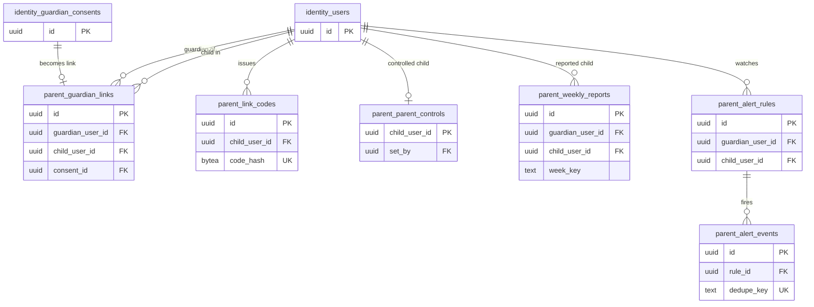

## 19. How to check these diagrams

- **Render:** open the file in a Markdown preview with Mermaid support, or run `npx -y @mermaid-js/mermaid-cli -i 02_database_erd.md -o /tmp/erd.svg`. Every block must render without a syntax error.
- **Coverage:** every table in `01` §3 appears in exactly one per-schema diagram, as a non-stub entity. Compare the `schema_table` names here with the §3 rows; the build-doc cross-reference script in [`16`](16_feature_traceability_matrix.md) §5 does this automatically.
