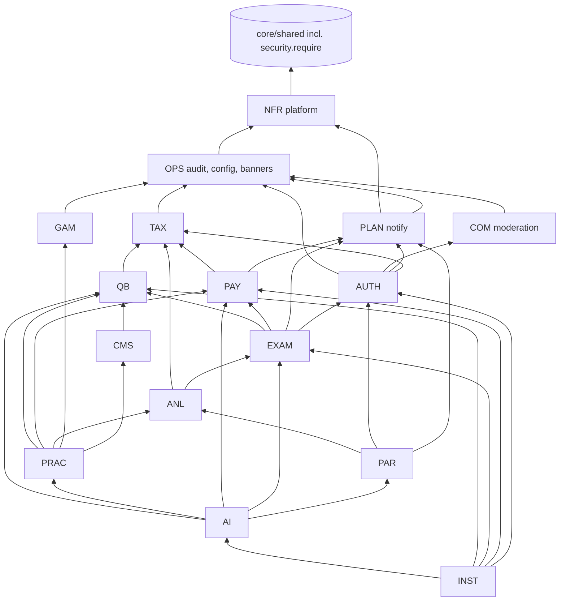
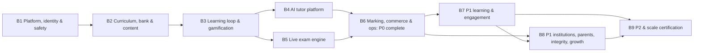

# 04 · Backend master plan

**Date:** 2026-11-27 · Read this before any build document. It fixes the architecture rules, the code layout, how modules talk to each other, the build order and the effort estimates. Database: [`01`](01_database_design.md). APIs: [`14`](14_api_contracts.md). Quality gates: [`15`](15_testing_and_quality_standards.md). Done: [`21`](21_definition_of_done.md).

---

## 1. What we are building

A FastAPI modular monolith on PostgreSQL 17 for a Bangladesh study platform: practice with a Mistake Notebook, live exams up to 200,000 candidates, an AI tutor grounded in verified sources, teacher-checked written marking, and gamification. There are 16 server modules (OFF is client-only) and five runtime entry points sharing one codebase.

| Deployable | Entry point | Contains | Scales on |
|---|---|---|---|
| `api` | `app.entrypoints.api` | All synchronous module routers | CPU, p95 latency |
| `workers` | `app.entrypoints.workers` | Postgres job runner: outbox relay, leaderboards, notifications, imports, OCR, rendering, rescoring, settlement, reconciliation, partition maintenance | Job queue depth and age |
| `ai-gateway` | `app.entrypoints.ai_gateway` | Tutor SSE, photo solve, provider calls, circuit breakers, admission control | Open streams, provider latency |
| `exam-ingest` | `app.entrypoints.exam_ingest` | Exam answer intake → SQS. **No Postgres import** (enforced). | Requests/s (pre-scaled before exams) |
| `exam-consumers` | `app.entrypoints.exam_consumers` | SQS consumers, scorer, close runs, merit, result precompute | SQS depth |
| `realtime` (B9) | `app.entrypoints.realtime` | WebSocket duel rooms (PRAC-13) | Open sockets |
| Edge Worker (B5) | `edge/` (TypeScript, Cloudflare) | `/edge/time`, paper key release | Edge (managed) |

## 2. Code layout

```
backend/
  pyproject.toml            # single config for ruff, mypy, pytest, coverage
  uv.lock                   # generated, exempt from the line rule
  .importlinter             # layers + exam-ingest isolation (< 60 lines)
  .pre-commit-config.yaml
  alembic.ini
  docker-compose.yml        # postgres:17 + pgvector, redis:7, localstack (SQS, S3), mailpit-free
  Dockerfile                # multi-stage; Node only in the worker image (KaTeX)
  scripts/
    check.sh                # format → lint → mypy → boundaries → line limit → tests
    check_file_length.py    # 200-line rule
    check_boundaries.py     # module-internal privacy via grimp
    check_coverage_paths.py # 95% on critical paths
  migrations/
    env.py
    helpers/                # partitions.py, rls.py, checks.py (handwritten, small)
    versions/               # one migration per table group, ≤ 200 lines
  src/app/
    core/                   # infrastructure only: settings, db, redis, http, errors, logging,
                            # security (jwt, crypto), ratelimit, idempotency, jobs runtime, storage, clock, ids
    shared/                 # pure helpers: poisha, bd_phone, dhaka_date, bangla_text, types
    entrypoints/
      api/  workers/  ai_gateway/  exam_ingest/  exam_consumers/  realtime/
    modules/
      registry.py           # module code → schema (tested against migrations)
      <module>/
        __init__.py         # PUBLIC API: functions and DTOs other modules may use
        contracts/          # PUBLIC: pydantic DTOs, event payload models, protocols
        internal/           # PRIVATE to the module
          models/           # SQLAlchemy models (this schema only)
          repositories/     # async query functions (no classes), take AsyncSession
          services/         # business logic; own transaction boundaries
          schemas/          # HTTP request/response models
          routes/           # FastAPI routers (thin)
          events/           # outbox producers and consumer handlers
          jobs/             # job handlers registered with the runner
          providers/        # external adapters (SMS, OCR, LLM, payment) where the module owns them
  tests/
    conftest.py             # db, client, redis, clock, factories
    core/  shared/  entrypoints/
    modules/<module>/       # unit/, integration/, api/ mirrors internal/
    contract/               # cross-module and event contract tests
    load/                   # k6 scenarios in JavaScript (not run in CI by default); Python post-run verifiers
edge/                       # Cloudflare Worker (TypeScript, B5), own lint/test config
```

**Public subpackages.** A module may expose a public subpackage beside `__init__.py` when an entry point or another module needs more than a function. The one current case is EXAM:
- `app.modules.exam.ingest` (B5) is imported by the `exam_ingest` entry point and is isolated from Postgres by `.importlinter`.
- `app.modules.exam.lock_registry` (B4/B5) is the tutor-lock authority read by `ai-gateway`.

Both live outside `internal/`, so no entry point or module imports another module's internals (R-26).

**This adds `internal/repositories/` and `internal/providers/` to the reviewed `prac/internal/` template** and replaces the single `contracts/` folder with "contracts/ plus `__init__.py`". Both need supervisor approval (decision S-3 in [`00`](00_architecture_review.md)).

## 3. Layering rules

| Layer | May import | May not |
|---|---|---|
| `routes` | its module's `schemas`, `services`, `core.http`, `core.security` deps | repositories, models, other modules |
| `services` | its `repositories`, `models`, `contracts`, `core.*`, `shared.*`, **other modules' public API** | `fastapi`, routes, other modules' internals |
| `repositories` | its `models`, `core.db`, SQLAlchemy | services, other modules |
| `models` | `core.db.Base`, SQLAlchemy | anything above |
| `contracts` | pydantic, `shared.*` | internals |
| `core` | `shared`, third-party | `modules`, `entrypoints` |
| `shared` | stdlib, pydantic | everything else |
| `entrypoints` | modules' public routers and job registries, `core` | module internals |

Enforced by `.importlinter` (layers `entrypoints > modules > core > shared`; exam-ingest forbidden from `sqlalchemy`, `asyncpg`, `alembic`, `app.core.db`) and `scripts/check_boundaries.py` (nobody imports `app.modules.X.internal` except X). Each module's `__init__.py` re-exports routers and job registrations for entry points through a function (`def routers() -> list[APIRouter]`, `def job_handlers() -> dict[str, JobHandler]`) so entry points never reach into `internal`.

**Routers contain no business logic.** A route parses the request schema, resolves the actor, calls exactly one service function and maps its DTO to the response schema. Error mapping is global (`core.errors`).

**No classes for repositories or services** (starter convention). Functions take `session: AsyncSession` first. Small dataclasses or pydantic models carry results. Protocols are used only where there are several real implementations (payment providers, social providers, LLM providers, OCR engines, SMS gateways, answer queue).

## 4. Module communication rules

1. **Synchronous calls** go through the target module's public functions in `app.modules.<m>`. Signature rule: the caller passes its `AsyncSession` when the call must join the caller's transaction (only the answer transaction: PRAC → ANL, GAM; payment capture: PAY → nothing else; admin writes: any → OPS `audited`). Otherwise the callee opens its own session.
2. **Events** go through the outbox: `nfr.publish(session, EventEnvelope)` in the producer's transaction. Consumers register job handlers (`kind = "<consumer>.<event_type>"`). Consumers are idempotent through `processed_events`.
3. **No module queries another module's tables**, not even read-only. If a read is hot (e.g. PRAC reading question versions), the owner exposes a cached read function (`qb.get_versions(ids)`) with an immutable-key cache.
4. **No circular imports between modules.** The allowed dependency direction is the graph in §5; `check_boundaries.py` also fails on any import cycle between module public APIs. When two modules need each other, the lower one publishes an event or exposes a protocol the higher one implements (e.g. EXAM's lock is read by AI through `exam.is_user_exam_locked()`, while EXAM never imports AI).
   **Leaf and near-leaf rules (from the independent review, R-03):**
   - **Authorization does not import AUTH.** `core.security` verifies the JWT and evaluates `require(actor, permission, scope)` from the token's role and scope claims plus the `auth:grants:{user_id}` cache that AUTH writes. Every module can check permissions without an AUTH edge, which removes the AUTH ⇄ COM and AUTH ⇄ PLAN cycles.
   - **OPS is a leaf** (depends only on NFR and core). Admin console endpoints live in the module that owns the data (`/v1/admin/users` in AUTH, refunds in PAY). OPS keeps only audit, runtime configuration, banners, notices, and from B8 campaigns, experiments and flags. Campaign sends go to PLAN as an event.
   - **PLAN does not import AUTH or PAR.** Facts it needs (minor status, guardian quiet hours) arrive by events and are stored in `notify.preferences`. Senders enqueue `plan.*` jobs or call `plan.send_*` (an edge into PLAN only).
   - **Rescoring is a PRAC job** (`prac.rescore_correction`) triggered by `correction.created`. CMS tracks progress from `rescoring.*` events and never imports PRAC, ANL or GAM.
   - **INST → AI only.** INST pushes `ai.request_marking(MarkingRequest)` and reads drafts with `ai.get_drafts()`. AI never imports INST.
   - **Deletion is event-driven.** AUTH emits `user.deletion_requested`; each module anonymises its own data and emits `user.deletion_completed{module}`.
   - **Exam answers reach PRAC by event.** PRAC consumes `exam.scored` and copies answers into `attempt_answers`; EXAM does not import PRAC.
5. **DTOs crossing modules are pydantic models in `contracts/`**, frozen, `extra="forbid"`. ORM objects never cross a module boundary.
6. **Configuration** comes only from `core.settings` (pydantic-settings) and `platform.runtime_config` (kill switches). No hardcoded URLs, keys, quotas or rule numbers; GAM rules live in `rewards.reward_rules`, quotas in `commerce.quota_policies`.

## 5. Module dependency graph



Arrows point from a module to what it depends on. The graph is acyclic; `check_boundaries.py` fails the build on any new edge that creates a cycle, and the allowed edge list is kept in `scripts/module_edges.toml` (reviewed like code). Events flow in the other direction without imports. For example: GAM consumes `exam.submitted`; PRAC consumes `exam.scored` and `correction.created`; CMS consumes `rescoring.*`; ANL consumes `marking.teacher_checked`; PLAN consumes notification events; every module with user data consumes `user.deletion_requested`. AI reads the PAR tutor-mode lock (B7 returns none until links exist in B8). ANL reads EXAM for chapter weights and exam history.

## 6. Build plan

### 6.1 Build dependency graph



B4 and B5 can run in parallel with two teams after B3; they share only the exam-lock contract (`exam.is_user_exam_locked`, Redis key `exam_lock:{user_id}`, fail-closed registry), which B4 defines and B5 implements the writer for. **Critical path:** B1 → B2 → B3 → B5 → B6 (exam engine is the longest, riskiest build).

### 6.2 Why this order

- **B1 first:** every module needs auth, roles, audit, outbox, job queue, idempotency, rate limits, settings, logging and the quality tooling.
- **AUTH-05 enrolments move to B2** because they reference TAX tracks and syllabus versions.
- **GAM ships with PRAC in B3** because the answer transaction writes XP and streak in the same transaction (v2 C8). Gamification is therefore validated from the first recorded answer.
- **PAY entitlements are in B3, gateways in B6:** practice and AI need access checks early; the pilot is free (v2 §8.1), so live payments are not on the critical path.
- **AI in B4, right after the learning loop:** the tutor needs answer context, quotas and verified content. Its only dependency on exams is the lock, defined as a contract.
- **EXAM in B5:** highest risk; needs QB, AUTH epoch, entitlements, PLAN reminders and GAM. Its load and fault-injection harness is built here.
- **B6 completes P0:** written marking needs the AI provider layer (B4) and rubrics (B2); commerce and ops close out launch scope; the restore drill is a v2 §8.2 gate.
- **B7–B8 are P1, B9 is P2:** all depend on attempt history or tenancy; B8 needs QB-10 variants from B7 for EXAM-09.

### 6.3 Consolidated build table

Effort is **backend engineering person-weeks** (implementation + tests + reviews), excluding client work and content operations. Ranges reflect the confidence in [`architecture-review.md`](../architecture-review.md) §2. **[Assumption]**

| Build | Objective | Modules | Features (count) | Complexity /5 | Depends on | Effort (pw) | Deliverables |
|---|---|---|---|---|---|---|---|
| 1 | Platform foundation, identity & safety | NFR, OPS, AUTH, COM, PLAN (SMS) | AUTH-01–04, COM-05, OPS-04 + foundations of NFR-05/06/07/08/09 (≈11) | 3 | — | 10–13 | Tooling, CI, 5 entry points booting, outbox, jobs, audit, OTP + Google + Facebook sign-in, staff SSO + 2FA, roles, consent, moderation |
| 2 | Curriculum, question bank & content workflow | TAX, QB, CMS, AUTH, NFR | TAX-01–04 (6), AUTH-05, QB-01–07, QB-09 (11), CMS-01–05 (5), part NFR-04/06a (≈25) | 4 | B1 | 10–14 | Taxonomy, versioned bilingual questions, blind verification, imports, rendering, lexical search |
| 3 | Learning loop & gamification core | PRAC, GAM, ANL, PAY, PLAN, CMS | PRAC-01–07, GAM-01–03, ANL-01, ANL-03, PAY-01–02, PLAN-01–02, CMS-04a (practice), NFR-09 answers (≈19) | 4 | B2 | 12–16 | Answer transaction, notebook, XP, streaks, boards, entitlements, inbox and push, rescoring |
| 4 | AI tutor platform | AI, NFR, QB, CMS | AI-01–05a, AI-15, AI-15a (9), QB-07a, QB-08, NFR-04, NFR-03 (AI) (≈13) | 5 | B3 | 13–18 | `ai-gateway`, grounded cited tutor, canonical cache, quotas, eval harness, photo solve, OCR import, dedupe, hybrid search |
| 5 | Live exam engine | EXAM, OPS, ANL, CMS | EXAM-01–08 (9), CMS-06, OPS-01a, ANL-02, NFR-01/01a/02/03 (≈16) | 5 | B3 (B4 lock contract) | 14–19 | Blueprints, ingest + SQS + consumers, two-phase close, contiguity, merit, results in Redis, control room, edge Worker, load harness |
| 6 | Teacher-checked marking, commerce & operations | AI, INST, PAY, OPS, NFR | AI-07–07d, INST-02a (6), PAY-03–05 (3), OPS-01–03 (3), NFR-06/06a/08/10 completion (≈16) | 4 | B4, B5 | 12–16 | Marking pipeline + teacher queue + accuracy reports, bKash/aggregator/Play, refunds, reconciliation, admin console APIs, banners, helpdesk integration, crawl detection, SLO alerts, restore drill. **P0 complete.** |
| 7 | P1 personalised learning & engagement | PRAC, ANL, QB, TAX, AI, PLAN, GAM, CMS, COM, AUTH | 34 P1 IDs | 4 | B6 | 16–22 | Adaptive, spaced repetition, Daily Mix, diagnostic, mastery, analytics, families, item stats, notes, flashcards, current affairs, AI quiz/summary/coach/diagnosis, badges, leagues, challenges, share cards, threads, mentors |
| 8 | P1 institutions, parents, exam integrity & growth | INST, AUTH, PAR, EXAM, PLAN, PAY, OPS | 32 P1 IDs + AUTH-01 Apple and email/password | 5 | B6, B7 | 24–32 (OMR is a computer-vision spike first) | Workspaces with RLS, rosters, seats, private bank, batch exams, OMR, paper PDFs, parent portal, anti-cheat, written exams, series, certificates, tracker, eligibility, subscriptions, family plan, affiliates, campaigns, flags, BI, iOS backend |
| 9 | P2 expansion & scale certification | all | 20 P2 IDs + scale work | 4 | B7, B8 | 26–36 (voice features each start with a speech-eval spike) | Realtime duels, voice, forum, groups, store, follows, team leagues, marketplace, white-label, attendance, sponsorships, consent dashboard and automated export/deletion, proctoring, predictor, PDF reports; replica routing; 100k and 250k rehearsals |
| **Total** | | 16 modules | **180 IDs** | | | **138–186** | |

**Calendar, from the critical path rather than total ÷ FTE** (independent review R-11). Builds run in sequence and stop for review. Inside a build, work parallelises only partly: B1–B3 have long serial chains (tooling → core → auth; schema → workflow; answer transaction → GAM → boards). B4 and B5 run in parallel as two teams of about 2.25 FTE each. Assume about 4.5 backend FTE and one review week per build boundary. **[Assumption]**

| Build | Effort (pw) | Calendar weeks |
|---|---|---|
| 1 | 10–13 | 3.5–4.5 |
| 2 | 10–14 | 3–4 |
| 3 | 12–16 | 3.5–4.5 |
| 4 ∥ 5 | 13–18 ∥ 14–19 | 6.5–9 (the longer of the two teams) |
| 6 | 12–16 | 3–4 |
| 7 | 16–22 | 4–5.5 |
| 8 | 24–32 | 6–8 |
| 9 | 26–36 | 6.5–9 |
| Review weeks | — | 8 |
| **Total** | **138–186** | **≈ 44–57 weeks** |

**P0 backend (B1–B6): 71–96 pw, about 24–31 calendar weeks including reviews.** The v2 week-28 launch assumed parallel client work, which the "backend before frontend" rule removes ([`00`](00_architecture_review.md) A.3 #3). These ranges are planning estimates (S-7). Re-baseline them after Build 1 using measured velocity.

### 6.4 Build-to-feature summary

The authoritative mapping (every one of the 180 IDs) is [`16_feature_traceability_matrix.md`](16_feature_traceability_matrix.md). Each build document lists its IDs in section A.

## 7. Patterns every build follows

| Concern | Pattern |
|---|---|
| Transactions | `async with session.begin():` in the service; repositories never commit. One request = at most one write transaction unless the build doc says otherwise (tutor uses two). |
| Errors | Services raise `core.errors` subclasses (`NotFoundError`, `ConflictError`, `ForbiddenError`, `ValidationAppError`, `TooManyRequestsError`, `LockedError`, `UnavailableError`). Routes never build error responses. |
| Validation | Pydantic v2 schemas with `extra="forbid"`, constrained types (`conint`, `constr`), `AwareDatetime`. Business validation in services. |
| Auth dependency | `actor: Actor = Depends(current_actor)`; `Actor` carries `user_id`, `session_id`, `roles`, `scopes`. Permission check: `await security.require(actor, "content.publish", scope)` from `core.security`, using the token claims plus the `auth:grants` cache. It does not import the AUTH module (§4). Relationship checks (batch member, guardian link) are done by the owning module. |
| Idempotency | `Depends(idempotent(route_id))` for POSTs marked R in [`14`](14_api_contracts.md). Answer and exam ids use their own keys. |
| Events | `await nfr.publish(session, event)` inside the write transaction. |
| Jobs | `@job("gam.leaderboard.apply")` handler functions; enqueue with `await nfr.enqueue(session, kind, payload, run_at=, dedupe_key=)`. |
| Admin writes | `async with ops.audited(session, actor, action, target, reason):` |
| Time | Inject `Clock` (`core.clock`) everywhere; never call `datetime.now()` directly; Dhaka dates through `shared.dhaka_date`. Tests use a frozen clock. |
| Ids | `core.ids.uuid7()` |
| Caching | Redis through small typed helpers in the owning module; immutable keys where possible (question versions, canonical answers). |
| External calls | HTTPX `AsyncClient` with explicit timeouts, retries with jitter only for idempotent calls, a circuit breaker per provider (`core.resilience`). |
| Logging | structlog; request id and trace id bound; never log PII, tokens or answer keys. |
| Metrics | Prometheus-style counters and histograms through OpenTelemetry; names `app_<module>_<thing>_<unit>`. |
| File size | Every handwritten file ≤ 200 lines; target 50–150. Split by subject (`services/answer_save.py`, `services/answer_replay.py`), never into `utils.py`. |

## 8. Standard start-of-session instructions for coding agents

Every build document begins with the same preamble. In short:

1. Read `README.md`, this document, the build document, and the sections of `01` and `14` it references.
2. Run `git log --oneline -5` and confirm the previous build's exit criteria are met (`scripts/check.sh` passes on `main`).
3. Create a branch `build/NN-<slug>`.
4. Implement in the order of section C; write tests alongside each step (section E).
5. Run `scripts/check.sh` after each step; never leave the tree red.
6. Verify section F; write the build report in the PR description.
7. **Stop after the build.** Do not start the next build or touch the frontend.
