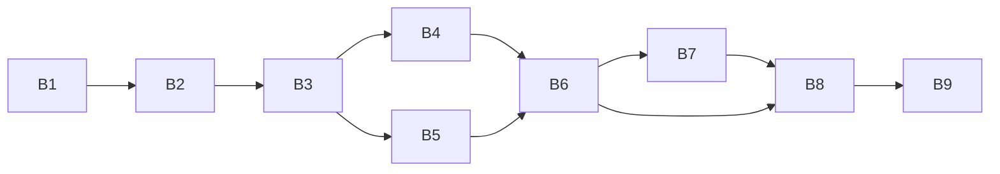

# Backend & database implementation plan

**Status:** planning complete, awaiting supervisor approval · **Date:** 2026-11-27 · **Scope:** the complete backend and database for all 180 requirements in [`features.md`](../../features.md), in nine builds. No frontend work until the nine builds are done.

The design source of truth is [`system-design-v2.md`](../system-design-v2.md). These documents turn it into an executable plan. Where they correct v2, the correction and its reason are in [`00_architecture_review.md`](00_architecture_review.md).

## Read in this order

| # | Document | What it settles |
|---|---|---|
| 00 | [Architecture review](00_architecture_review.md) | Inconsistencies in existing documents, corrections, supervisor decisions, independent review of this plan |
| 01 | [Database design](01_database_design.md) | Conventions, every table (inventory and specifications), transactions, concurrency, idempotency, retention, pooling, backup, partitioning, growth |
| 02 | [Database ERD](02_database_erd.md) | Mermaid diagrams: overview and one per schema |
| 03 | [Migration plan](03_database_migration_plan.md) | Alembic setup, ordered migrations per build, seeds, expand/contract, zero downtime |
| 04 | [Backend master plan](04_backend_master_plan.md) | Code layout, layering and module communication rules, dependency graph, nine-build overview, effort |
| 05–13 | Builds [1](05_build_01.md) · [2](06_build_02.md) · [3](07_build_03.md) · [4](08_build_04.md) · [5](09_build_05.md) · [6](10_build_06.md) · [7](11_build_07.md) · [8](12_build_08.md) · [9](13_build_09.md) | Each one self-contained for a coding session: overview, database, files, APIs, tests, exit criteria |
| 14 | [API contracts](14_api_contracts.md) | Global conventions and the canonical endpoint index |
| 15 | [Testing and quality](15_testing_and_quality_standards.md) | Ruff, mypy, pytest, HTTPX, coverage, pre-commit, CI gates, the 200-line rule |
| 16 | [Feature traceability](16_feature_traceability_matrix.md) | All 180 IDs → module, tables, endpoints, build, tests |
| 17 | [Scalability and performance](17_scalability_and_performance.md) | Workload model, stages 1k → 100k+, exam scale, load testing |
| 18 | [Security architecture](18_security_architecture.md) | Auth (OTP, Google, Facebook, Apple), OWASP API Top 10, PII, minors, tenancy, AI safety |
| 19 | [DevOps and deployment](19_devops_and_deployment.md) | Docker, environments, CI/CD, deploy and rollback, observability, incidents |
| 20 | [Risk register](20_risk_register.md) | Risks with owners, signals and mitigations |
| 21 | [Definition of done](21_definition_of_done.md) | Change, build and release checklists |

## The nine builds at a glance

| Build | Name | P0 complete? |
|---|---|---|
| 1 | Platform foundation, identity & safety | |
| 2 | Curriculum, question bank & content workflow | |
| 3 | Learning loop & gamification core | |
| 4 | AI tutor platform | |
| 5 | Live exam engine | |
| 6 | Teacher-checked marking, commerce & operations | **Yes: all 93 P0 IDs** |
| 7 | P1 personalised learning & engagement | |
| 8 | P1 institutions, parents, exam integrity & growth | |
| 9 | P2 expansion & scale certification | All 180 IDs |

## Engineering rules that apply everywhere

- Every handwritten file is at most **200 lines**; most are 50–150. This covers source, tests, migrations and the edge Worker. Generated files are listed in `.line-limit-exempt`.
- **Ruff, mypy strict, pytest, HTTPX, pytest-cov and pre-commit** run from Build 1. Every build ends with zero lint, format or type errors, zero failing tests, 85% overall coverage and 95% on critical paths.
- A module touches only its own schema; other modules are reached through their public API or events.
- Money is integer poisha. Times are UTC `timestamptz`. Bangladesh dates are stored explicitly.
- No capacity claim without a benchmark.

## Using a build document in a new session

Give the coding agent: this README, [`04`](04_backend_master_plan.md), the build document, and the sections of [`01`](01_database_design.md) and [`14`](14_api_contracts.md) it names. The agent implements that one build, runs `scripts/check.sh`, verifies section F, and stops.
