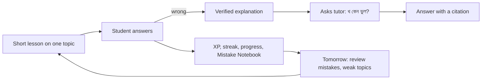
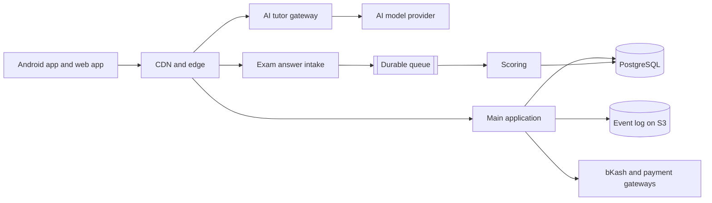

# Project summary: Bangladesh study platform with an AI tutor

**For:** project supervisor review · **Date:** 2026-11-26 · **Status:** Design complete; ready to start building

**Full detail:**

- [`system-design-v2.md`](system-design-v2.md): the design the team builds from.
- [`architecture-review.md`](architecture-review.md): the independent review that shaped it.
- [`features.md`](../features.md): the requirements.
- [`market-validation.md`](market-validation.md): education-system fit, competitors and the open question of what makes the app stand out.

Figures marked *est.* are planning estimates, not measurements.

---

## 1. What we are building

A Duolingo-style study app for Bangladesh. Its users are:

- Class 6–12 students
- university admission candidates
- government and bank job candidates

A student can:

- do a short daily session
- understand each mistake with an AI tutor that answers in Bangla, English or Banglish
- see their progress
- know what to practise tomorrow

Students preparing for an exam can go straight to a chapter, a past paper or a scheduled national mock exam.

**Scope.** 177 requirements across 17 modules:

| Priority | Count | Meaning |
|---|---:|---|
| P0 | 87 | Needed for launch |
| P1 | 70 | Soon after launch |
| P2 | 20 | Later |

Every requirement has an owner and a place in the design. The two pillars, the **AI tutor** and **gamification**, are both part of the launch.

## 2. How a learning session works

**Every answer is recorded once.** That single record updates the Mistake Notebook, progress, XP and streak together. It also feeds an event log used later for adaptive practice and analytics.

**The tutor only answers from checked sources:** the verified question bank and, if licensed, the NCTB textbooks. Every answer carries a citation. If no source supports an answer, the tutor says it isn't sure. It is switched off by the server during live exams.

## 3. Architecture in one picture

| Decision | Choice | Why |
|---|---|---|
| Overall shape | One modular application, plus two separately scaled parts: exam answer intake and the AI tutor | A 10-person team can run one application safely. Only the exam path and the AI path need their own scaling and failure isolation. |
| Backend and database | Python (FastAPI) and PostgreSQL | Proven, low-cost. One database keeps learning records consistent. |
| Apps | One React Native codebase for the Android app and the web app | Must run on Android 8 phones with 2–3 GB RAM and stay under about 30 MB. Confirmed by a device test in week 2. |
| AI | Claude models: a cheaper model for simple explanations, a stronger one for maths and photos | Models are chosen by a Bangla, Banglish and maths test, not by reputation |
| Hosting | AWS (Mumbai) with a Cloudflare CDN | Close to Bangladesh. No local-storage requirement was found in the 2026 data law; transfer rules need a legal check. |

## 4. The three hardest problems and how the design handles them

| Problem | Approach |
|---|---|
| **Live exams for up to 200,000 students at once** | Papers are prepared in advance and downloaded encrypted before the start; the key is released at start time. Every answer is saved on the phone first, then confirmed by the server only after it is stored durably. The server checks that no confirmed answer is missing before results are published. Launch exams are capped at 20,000, rising to 200,000 after staged rehearsals. |
| **An AI tutor students can trust** | Answers are grounded in verified sources and cited. The answer key is never contradicted. Maths answers are re-checked by an algebra tool. Answers shared between students contain no personal data. Practice keeps working if the AI is down. Release depends on passing accuracy, citation, safety, speed and cost tests. |
| **Fair gamification** | XP comes only from learning actions, with daily caps. Streaks use Bangladesh dates and handle answers given offline. XP, mastery and official exam merit are three separate records, so an XP bug cannot change an exam rank. Minors appear on leaderboards with first name and institution only, and can opt out. |

## 5. Plan and milestones

| Week | Milestone |
|---|---|
| 2 | Device test of the app on a 2 GB Android phone; AI model and OCR shortlist chosen |
| **6** | **First complete learning session** on a test server, including the AI tutor, XP and streak |
| 8 | Exam answer path tested with 20,000 simulated students and injected failures |
| 10 | Exam alpha; first full AI tutor evaluation |
| **16** | **Free pilot** with 2,000–5,000 students on one track |
| 20 | Payments live; security penetration test |
| **28** | **Launch** (week 24 if three more people join by week 6) *est.* |
| Launch + 6–10 weeks | First 200,000-student national exam, after rehearsals *est.* |

If building starts the week of 30 November 2026, week 16 falls during SSC 2027 (from 14 March 2027), so **the pilot is for SSC 2028 students**.

**Building in parallel from week 1:**

- core platform
- content and question bank
- practice
- AI tutor
- gamification
- the apps

## 6. Team and resources *est.*

**Engineering:** 10 engineers (3 backend, 2 web, 2 Android, 1 AI/ML, 1 platform, 1 QA). The review recommends three additions:

- one client engineer moving to backend from week 8
- a contracted OCR and evaluation engineer
- a second QA engineer from week 12

**Content:** subject reviewers to check questions and answer keys. If the existing question bank is not yet verified, the pilot track needs about 7 reviewers. If it is already verified, about 1.

**Teachers:** 22–38 teacher-weeks to build and grade the AI tutor's test sets.

**Running costs** *est.*, excluding salaries:

- **Pilot month:** about US$1,675 (৳204,000), including about US$640 of AI usage.
- **A 200,000-student national exam day:** about US$340 extra, or about US$1,490 if every candidate gets an SMS reminder.

## 7. Main risks

| Risk | What we do about it | Checked by |
|---|---|---|
| Not enough verified questions by the pilot | Time 200 real questions through review in week 1; verify only the launch tracks first | Week 2 |
| AI tutor quality in Bangla, Banglish and handwritten maths; rights to use NCTB textbooks | Test shortlisted models on 100 items; ask for textbook rights early; cite verified explanations if rights are refused | Weeks 4 and 10 |
| Exam correctness at national scale | Fault-injection tests at 20,000, then staged rehearsals before larger exams | Week 8 |
| Team capacity in backend, AI, platform and QA | Check progress against plan at week 4; add people or move the launch date | Week 4 |
| Google Play requires its own billing for subscriptions sold in the Android app (15% fee) | Sell by bKash and gateways on the web; decide on in-app Play Billing; apply for gateway accounts in week 1 | Week 6 |
| Established apps already offer the planned features, including AI marking of written answers | Test our marking against real teachers before building; compete on measured, visible accuracy | Week 4 |

## 8. Decisions still open

Building starts on a sensible default for each. A different answer changes only the parts named in the design (§10 of `system-design-v2.md`).

| # | Decision | Default used meanwhile | Needed by |
|---|---|---|---|
| D1 | Permission to use and quote NCTB textbooks | Tutor cites the verified question bank | Week 4 |
| D2 | Sell inside the Android app through Google Play, or only on the web | Payments built for the web first | Week 6 |
| D3 | Which AI models pass our Bangla, Banglish and maths tests | Claude Haiku 5.5, Sonnet 5.5 and Opus 5.5; photo solve labelled beta | Week 10 |
| D4 | Legal review under the 2026 data law: guardian consent, sensitive data, retention, transfer abroad | Guardian consent by OTP at sign-up; Mumbai hosting | Week 4 |
| D5 | Does launch need 200,000-student exams, or is that the target ceiling? | Launch cap 20,000 | Week 8 |
| D6 | Gamification fine print (late answers, corrections, minors on leaderboards) | The rules in design §5 | Week 3 |
| D7 | When late exam answers are accepted and when results publish | Late answers accepted for 10 minutes; provisional score within 5 s; results 15 minutes after the end or later | Week 2 |
| D8 | Rights to questions scanned from books and past papers | Unknown rights cannot be published | Week 4 |
| D9 | Should AI marking of handwritten written answers be in the launch? | No, until an accuracy test against two teachers passes | Week 4 |

## 9. How progress will be judged

**Launch requires every P0 requirement to be demonstrated, plus measured passes on:**

- **AI tutor:** at least 90% correct explanations; every citation resolves to a real source; zero unsafe answers in safety tests.
- **Exams:** no confirmed answer lost under injected failures; provisional score within 5 seconds.
- **Phones:** under 30 MB download; under 300 MB memory during a 60-minute exam; answers recovered after the app is killed.
- **Speed:** next question in under 300 ms on a 3G profile.
- **Payments:** duplicate, missing-webhook, refund and reconciliation cases all pass.
- **Security:** a penetration test with no open high or critical findings, and a tested database restore.

None of these has been measured yet. They are the targets the team builds against.
