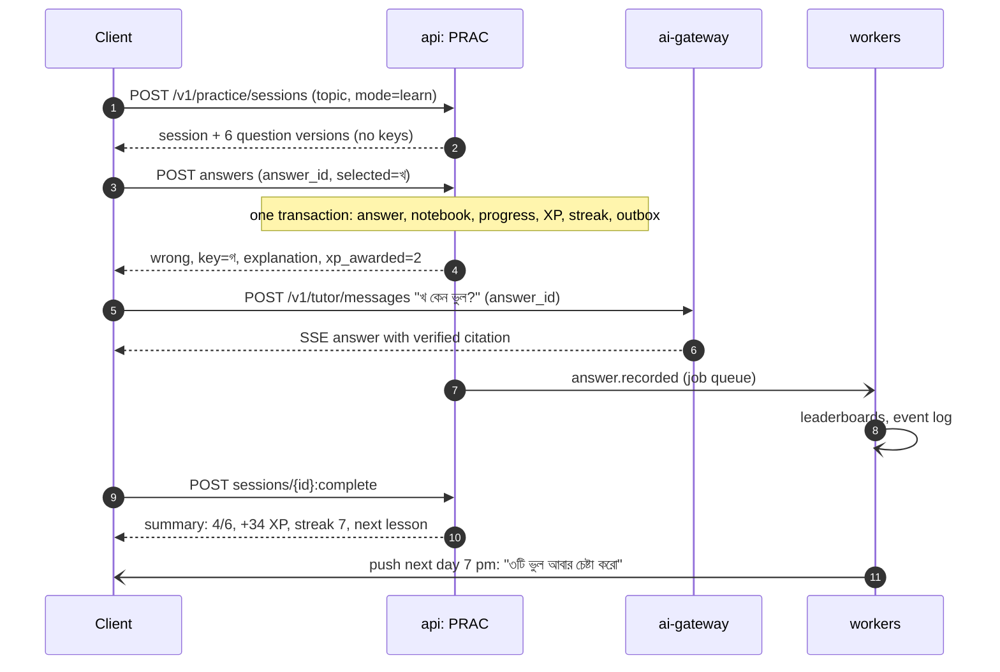
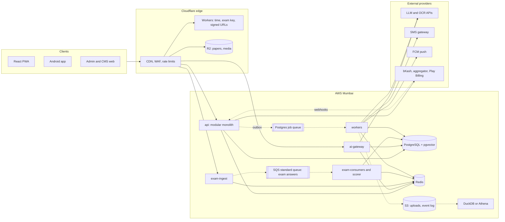
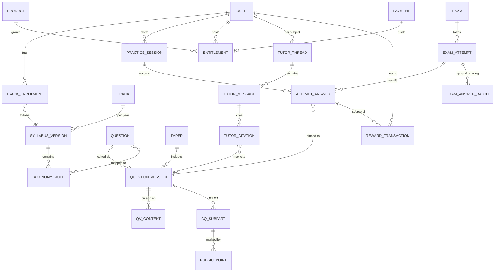
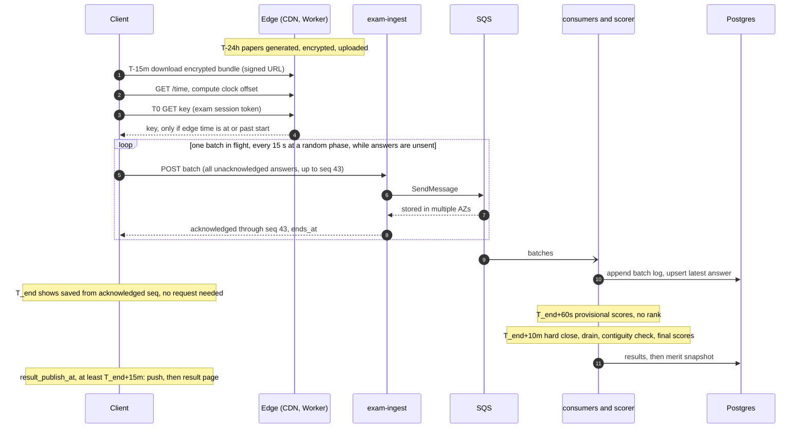
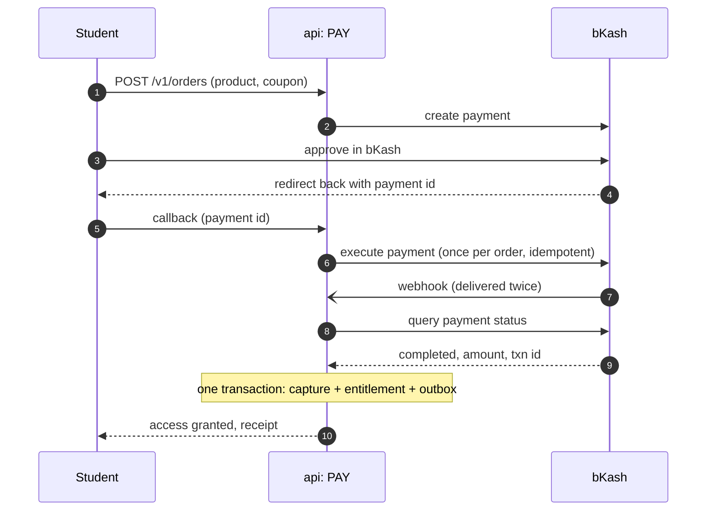

# System design v2: Bangladesh practice + AI tutor platform

**Version:** 2.0 · 2026-11-26 · **Status:** Baseline for build · **Requirements:** [`features.md`](../features.md) v1.0 · **Supersedes:** [`system-design.md`](system-design.md) v1.0 · **Review applied:** [`architecture-review.md`](architecture-review.md)

## Context

`features.md` lists 177 requirements in 17 modules (87 P0, 70 P1, 20 P2). This is a greenfield design. It is written for the engineering team making its first database, API, mobile and deployment decisions. P0 defines launch acceptance; every P1 and P2 feature has an owner, dependencies and a place in the architecture (§8.4, §9).

Three things shape the design:

- **Two pillars at launch.** AI tutor and gamification P0 ship with practice, exams and content. Section 18's build order (AI at step 4, GAM at step 3, both after the "MVP") is replaced by parallel workstreams in §8.1.
- **One attempt record feeds everything.** Mistake Notebook, progress, XP, streak, next practice, item statistics and the tutor's context are all derived from the same recorded answer.
- **Exam day is a different workload.** 200,000 candidates starting together gets its own ingest path, isolated from the rest.

Labels:

- **[Rule]**: a product rule proposed here, not taken from `features.md`.
- **[Assumption]**: a planning number to replace with real data.
- **[Decision]**: a default adopted so building can start. The product owner confirms or changes it by the date in §10.
- **[Needs evidence]**: a fact about an outside provider that must be checked before that part is built.

### What changed from v1

v2 applies the pre-build review. Section numbers are unchanged from v1, so the coverage table (§9) still maps every feature ID.

| # | Change | Review reference | Sections |
|---|---|---|---|
| C1 | Exam answers: one batch in flight per client, an append-only batch log, a two-phase close (provisional at end + 60 s, hard close at end + 10 min), a contiguity check, merit no earlier than end + 15 min | §3.1 | §3.1, §3.5, §6.2, §6.3 |
| C2 | Autosave at a random phase per client; results precomputed in Redis; "sign in now" push at T−24 h; SQS standard queue | §3.1, §4.4 | §6.1, §6.2, §6.4 |
| C3 | Live exams show a provisional score without rank within 5 s by default | §3.5 (NFR-02) | §6.4, §7.5 |
| C4 | Practice answer ids are unique per user, not globally | §3.3 | §3.1, §3.5 |
| C5 | The shared tutor cache is generated without personal context; the free-form semantic cache moves to P1 | §3.2 | §4.1, §4.2, §4.6 |
| C6 | One AI provider at P0; no transliteration step, no reranker, one OCR read per photo | §6 (S5) | §0.4, §4.1–§4.7 |
| C7 | AI cost gates set per route | §3.2 | §4.8 |
| C8 | Mistake Notebook, progress, XP and streak are written in the answer's transaction | §6 (S1) | §1.2, §3.5, §3.6 |
| C9 | Background jobs run from a Postgres job queue; SQS only for exam answers | §6 (S2) | §0.2, §2.3, §3.5 |
| C10 | No ClickHouse at P0: event log as Parquet on S3, queried with DuckDB or Athena | §6 (S3) | §0.2, §2.3, §3.6 |
| C11 | One learner codebase for Android and web (React Native + react-native-web), confirmed by the week-2 spike | §6 (S4) | §0.2, §0.3 |
| C12 | Gamification rules settled: leaderboards by recorded time, per-day rules by effective date, final streak settlement, rapid guesses flagged rather than blocked | §3.3, §6 (S7) | §5 |
| C13 | Minors shown on boards with first name and institution, with opt-out, as NFR-07 states | §3.3 | §5.7, §7.5 |
| C14 | bKash execute step, partial refunds, overlapping entitlements, settlement-file fallback | §3.4 | §7.2 |
| C15 | Institution rank labelled "self-reported" until verified rosters exist | §3.5 (EXAM-06) | §5.4, §6.2, §7.5 |
| C16 | One paper set per language at P0 | §6 (S8) | §6.2 |
| C17 | Launch live exams capped at 20,000; 50,000 and 200,000 after staged rehearsals | §6 (S9), D5 | §0.1, §6, §8 |
| C18 | Search without a custom stemmer unless the search gate fails | §6 (S10) | §7.1 |
| C19 | Helpdesk bought; blog and SEO on a static site; admin console on an admin framework | §6 (S6) | §7.4 |
| C20 | Email and password sign-in deferred to P1 | §6 (S11) | §3.4 |
| C21 | Content operations workstream, reviewer sizing, staffing additions, launch at week 28 (week 24 if staffed) | §4 | §0.1, §8.1 |
| C22 | Content rights recorded on every question; unknown rights cannot be published | D8 | §3.1, §7.1 |
| C23 | New release gates for exam correctness, cache privacy and id scoping | §3 | §8.2 |
| C24 | Costs updated: Bangla SMS at 2 segments, no ClickHouse | §3.5 | §8.6 |
| C25 | Decisions D1–D8 with owners, dates and the defaults adopted | §5.2 | §10 |

Option **S12** (exam answers written straight to DynamoDB) is not adopted. It is evaluated in the week-8 exam ingest prototype (§8.1).

## 0. Assumptions and stack decisions

### 0.1 Assumptions

| Area | [Assumption] |
|---|---|
| Team | 10 engineers: 3 backend, 2 web, 2 Android, 1 AI/ML, 1 platform/SRE, 1 QA. **Recommended additions** (review §4.1): one client engineer moves to backend from week 8; one contracted OCR and evaluation engineer; a second QA engineer from week 12. |
| Content team | Authors and reviewers, sized in §8.1: about 7 full-time reviewers for the pilot track if the bank is unverified, 1 if it is already verified. |
| Teacher time for AI evaluation | 22–38 teacher-weeks before launch (§4.8). |
| Timeline | **[Decision]** P0 launch at week 28; week 24 only if the staffing additions are in place by week 6. A free pilot from week 16. |
| Pilot traffic | 10,000 monthly users, 3,000 daily, 300 concurrent at peak. |
| Year-1 traffic | 500,000 registered, 60,000 daily, 6,000 concurrent outside exams. |
| Live exam | Design ceiling 200,000 concurrent, 100 MCQ, 60 minutes (NFR-01). **[Decision]** Launch exams are capped at 20,000 registrants; 50,000 and 200,000 follow staged rehearsals (C17). |
| Content at launch | 150,000 questions, 60 NCTB textbooks (about 15,000 pages). How much of the bank is already verified is unknown and is measured in week 1 (§8.1). |
| Hosting | AWS ap-south-1 (Mumbai) plus Cloudflare edge. No legal requirement to host inside Bangladesh (open decision D4). |
| Currency | ৳122 per US$1, for estimates only. |

### 0.2 Stack evaluation

| Choice | Verdict | Reasoning |
|---|---|---|
| **FastAPI** (Python 3.13) | Adopt | Fits a modular monolith; same language as the AI and OCR code; OpenAPI output generates the TypeScript client. Its per-core throughput is modest, which matters only for exam ingest. That path is I/O-bound and scales horizontally (§6.2), so no second language is needed. |
| **PostgreSQL** 17 | Adopt as the only system of record | Relational integrity for attempts, payments and ledgers; row-level security for institutions; `pgvector` and `pg_trgm` cover launch search. Managed (RDS Multi-AZ) with PgBouncer. |
| **React Native + react-native-web** for the learner app; **React** (Vite, TypeScript) for admin and CMS | Adopt, confirmed by the week-2 spike (C11) | One learner codebase for Android and web instead of two. If the web build misses the PWA targets in §6.6, the learner web app falls back to plain React sharing the same TypeScript core. |
| Redis | Add | Rate limits, quotas, leaderboards, exam locks, caches. Never the system of record. |
| SQS | Add, for exam answers only | Durable multi-AZ **standard** queue (FIFO queues have throughput quotas that would bind). |
| Job queue | Postgres table (C9) | All other background work runs from a job table using `SELECT … FOR UPDATE SKIP LOCKED`. Revisit above about 1,000 jobs per second. |
| Warehouse | S3 + DuckDB or Athena at P0 (C10) | Events land in S3 as Parquet (NFR-09). Add ClickHouse when dashboard latency or query volume needs it (§8.4). |
| Search engine | Defer | Launch on Postgres (§7.1). Move to OpenSearch if search p95 exceeds 300 ms or the index passes 5 million documents. |

### 0.3 Android approach

Targets from OFF-01: Android 8+, 2–3 GB RAM, APK under about 30 MB.

| Option | Download size | Low-RAM behaviour | Fit |
|---|---|---|---|
| Trusted Web Activity around the PWA | about 2 MB | Depends on the device's Chrome version; no `FLAG_SECURE`; weaker background sync | Rejected: exam recovery and EXAM-09a need native control. |
| **React Native (Hermes, new architecture)** | 15–20 MB per ABI | Good with list recycling and one reused WebView for question content | **Chosen.** Also serves the learner web app through react-native-web, so Android and web share screens, the API client, sync engine, session state machines and strings. iOS (OFF-04) reuses it. |
| Flutter | 10–15 MB per ABI | Good | Viable, but a second language and no code shared with web. |
| Native Kotlin | 8–12 MB | Best | Fallback for the exam screen only, if the spike below fails. |

Decision gate, week 2: build the exam screen in React Native and run it on a 2 GB Android 8.1 device. Pass means cold start under 3 s, question switch under 100 ms, memory under 300 MB PSS and download under 25 MB. If it fails, the exam screen becomes a Kotlin module inside the same app.

The same spike builds the web target. It must pass the PWA targets: initial JavaScript under 170 KB compressed and first load under 4 s on BD-3G (§6.6). It also renders server-rendered maths in the oldest supported Android System WebView on the Android 8.1 device.

Maths is rendered once at publish time (KaTeX on the server, output stored as HTML per question version). Clients display it with only the KaTeX stylesheet and fonts, bundled in the app, and no maths engine. This saves CPU and bundle size on low-end phones.

### 0.4 AI options

| Stage | Choice |
|---|---|
| Prototyping, free or open source | Open-weight models through Ollama or vLLM for offline experiments; Gemini API free tier with **synthetic or eval data only**, because Google states free-tier data is used to improve its products. `bge-m3` (open source, multilingual) for embeddings. Surya and Tesseract `ben` as printed-text OCR baselines. |
| Production routing | One provider at P0 (C6). Cheap: `claude-haiku-5-5`. Strong: `claude-sonnet-5-5`. Top tier for failed verification and (P1) grading: `claude-opus-5-5`. When the provider fails, the tutor degrades to verified explanations and cached answers (§4.5). The provider interface lets a second vendor be added after launch if one passes the eval. |
| Selection rule | No model goes to production on reputation. Each route's model is whichever passes the launch eval (§4.8) at the lowest cost. Bangla and handwritten-maths quality are unknown until measured. |

---

## 1. One learning session

### 1.1 From syllabus topic to lesson

- The home screen is a path of topics per subject, ordered by TAX-04 ordering for the student's track enrolment and syllabus year.
- A **lesson** is a generated 5–8 question session for one topic. **[Rule]** Composition: one recall item, two or three application items, one past-paper item, and one item from the student's Mistake Notebook for this subject if any exist. An optional concept card (QB-04 linked note) opens the lesson.
- Selection sits behind one interface, `NextQuestionPolicy`. P0 uses a rule-based policy (unseen first, author difficulty rising). P1 swaps in the adaptive policy without changing the session API.
- Exam-prep entry points bypass the path: chapter practice (PRAC-03), past papers (PRAC-04), custom builder (PRAC-01) and scheduled mocks (EXAM-02) all sit under a "Jump to" tab.

### 1.2 The SSC physics walk-through

Rafi, Class 10 Science, Bangla version, enrolled in "SSC Science 2027". He opens the lesson "নিউটনের গতিসূত্র".



| Step | What Rafi sees | Owner of the write | Record written |
|---|---|---|---|
| Start | Six questions load at once; switching is instant | PRAC | `practice_sessions`, `session_items` pinned to `question_version_id` |
| Wrong answer | Red on খ, green on গ, verified explanation, "+2 XP" | PRAC, calling GAM and ANL in-process | `attempt_answers`, `mistake_entries`, `topic_progress`, `reward_transactions`, `streak_days` and the `answer.recorded` outbox row, in one transaction |
| "খ কেন ভুল?" | Streamed Bangla answer, citation chip "পদার্থবিজ্ঞান ৯-১০, অধ্যায় ৩, পৃ. ৫৮" | AI | `tutor_messages`, `tutor_citations`, `ai_usage` |
| Finish | Score, XP earned, streak flame, daily-goal ring, "tomorrow" card | PRAC closes the session | `session.completed` event |
| Background, under 2 s | — | GAM | Leaderboard scores in Redis |
| | — | NFR-09 pipeline | Event in the S3 log |
| Next day | Push at his usual study hour; home shows "Review 3 mistakes" first | PLAN sends; PRAC builds the set | `notifications` |

**One transaction for core learning state (C8).** The answer, the Mistake Notebook entry, topic progress, XP ledger rows and the streak day are written together inside `api`; all live in the same database. GAM and ANL run inside a savepoint. If their write fails, the answer still commits, the failure is logged, and a repair job replays the reward from the answer (rewards are idempotent on their key). The response returns the XP actually awarded. Only leaderboards, notifications and the event log are asynchronous.

**Mistake Notebook (PRAC-05).** A wrong or skipped answer adds the question. The entry is recomputed from `attempt_answers`, rescored by any `score_adjustments`, in effective-time order, rather than kept as a counter. A question stays in the notebook until its two most recent rescored answers are correct. Out-of-order or replayed answers cannot corrupt it.

**Next practice at P0.** The "tomorrow" card ranks: open mistakes in this subject, then the weakest topics (ANL-03), then the next topic on the path.

### 1.3 Tutor access and answer visibility

| Mode | Correctness and key | Explanation | Tutor |
|---|---|---|---|
| **Learn** (PRAC-02) | Immediately after each answer | Immediately | Before answering: hints only, and the server leaves the key out of the tutor's context. After answering: all AI-04 actions. |
| **Test** (practice test, mock, model test) | After submit. Keys are not in the payload. | After submit | **[Rule]** Requests that reference a question in an open test attempt are refused with `409 attempt_open`. General chat stays available; it is self-practice. |
| **Live exam** | At `result_publish_at` | At `solution_unlock_at` | Locked for the user on every device, enforced by the server (§4.6). |

### 1.4 Jumping straight in

Chapter practice, past papers and mocks create the same `practice_sessions` or `exam_attempts` records and emit the same events. The path and the "Jump to" tab are two entrances to one loop.

The rest of the P0 practice and progress surface uses the same records:

- **Custom builder (PRAC-01)** is a filter over the bank (nodes, count, time limit, difficulty, source, type, negative marking) that produces a session.
- **Textbook-exercise mode (PRAC-03)** selects questions whose source is the textbook exercise.
- **Bookmarks, folders and notes (PRAC-06)** are PRAC tables keyed by question, not version, so they follow corrections.
- **Report error (PRAC-07)** on every question creates a CMS error report (§7.1).
- **Dashboard (ANL-01).** Accuracy by subject, chapter and topic, attempts, study time and streak come from `topic_progress`. **[Rule]** Readiness per track is syllabus coverage × recent accuracy, weighted by each chapter's share of marks in the exam blueprint.
- **Exam history (ANL-02)** reads `exam_results` for score and rank trends.
- **Weak areas (ANL-03)** are the lowest-accuracy topics with at least 10 attempts; one tap starts a session on that topic.

### 1.5 P1 extensions of the loop

| Feature | What changes | What stays |
|---|---|---|
| Adaptive practice (PRAC-08) | `NextQuestionPolicy` becomes Elo-based: per-topic ability updated from `answer.recorded`, next item chosen for a 60–75% predicted success rate. Needs item difficulty from QB-11. | Session API, attempt record |
| Spaced repetition (PRAC-09) | A new consumer keeps `review_cards` (FSRS state, due date) for mistakes and flashcards. | Same event |
| Daily Mix (PRAC-10) | A composer builds one set per Dhaka day: 40% due reviews, 40% weak topics weighted by exam importance, 20% new path material. **[Rule]** Created on first open; unique on (user, enrolment, date). | Runs as a normal session |
| Diagnostic (PRAC-12) | A fixed-blueprint session at onboarding seeds ability and `mastery_state`. | Same attempt record |
| Mastery map (ANL-04) | `mastery_state` levels derived from ability and recency. TAX-06 links share mastery across tracks. | Rebuildable from attempts |

All five need historical attempts. That is why NFR-09 capture starts with the first answer in week 3 (§8.1).

---

## 2. Deployment and data ownership

### 2.1 Recommendation

**A modular monolith with workers, plus two isolated paths.** One repository, one Python codebase, four deployables.

| Deployable | Contains | Why separate |
|---|---|---|
| `api` | All 17 modules' synchronous APIs | — |
| `workers` | Postgres job runner: outbox relay to the event log, leaderboards, imports and OCR, notifications, reconciliation, rescoring | Queued work must not compete with requests |
| `exam-ingest` and `exam-consumers` | Answer intake, durable acknowledgement, append-only answer log, scoring, precomputed results | Independent scaling to 15,000 requests/s and failure isolation (NFR-01) |
| `ai-gateway` | Tutor streaming, provider calls, circuit breakers | Long-lived connections and a slow external dependency must not exhaust `api` workers (NFR-03) |

### 2.2 Monolith or services

| Criterion | Modular monolith + workers | Independent services |
|---|---|---|
| Team of 10 | One deploy pipeline, one on-call surface | 10 or more pipelines and a platform team we do not have |
| Learning-record correctness | Attempt and outbox event commit in one local transaction | Distributed transactions or sagas from day one |
| Changing boundaries | A refactor | A migration |
| Independent scaling | Only where split out (exam, AI) | Everywhere, mostly unneeded |
| Failure isolation | Weaker inside `api`; mitigated by the two isolated paths | Stronger |

Module boundaries are enforced in code: each module owns a Postgres schema, exposes a Python interface and events, and may not import another module's models or query its tables (checked by `import-linter` in CI).

**Measurements that would justify a later split:**

| Candidate | Split when |
|---|---|
| Search | p95 above 300 ms, or the index passes 5 million documents |
| Gamification | Leaderboard and reward work exceeds 30% of worker CPU, or its deploy cadence blocks others |
| Notifications | Campaign sends (OPS-05) delay transactional pushes by more than 60 s |
| CMS | The content team needs releases during exam freeze windows |
| Any module | Its incidents cause more than 25% of `api` error-budget burn for two consecutive months |

### 2.3 System diagram

Solid arrows are synchronous calls. Dashed arrows are queued work.



### 2.4 The 17 modules

Sync = in-process call or HTTP. Queue = event through the outbox and the Postgres job queue (exam answers use SQS). Ext = external provider.

| Module | Responsibility | Data owned (schema) | Main interface or event | Depends on |
|---|---|---|---|---|
| AUTH | Accounts, sessions, roles, profiles, enrolments, consent | `identity` | Sync `whoami`, `can()`; event `enrolment.created` | Ext: SMS, Google sign-in |
| TAX | Tracks, taxonomy tree, syllabus versions | `curriculum` | Sync read API, cached at the edge | — |
| QB | Questions, versions, translations, papers, imports, duplicates | `qbank` | Sync `get_versions()`; events `question.published`, `question.corrected` | TAX. Ext: OCR, embeddings |
| CMS | Editor, workflow, review queues, error reports | `cms` | Admin web; event `error_report.resolved` | QB, AUTH |
| PRAC | Sessions, answers, notebook, bookmarks, notes | `practice` | Sync answer API; events `answer.recorded`, `session.completed` | QB, PAY (entitlement check) |
| EXAM | Blueprints, exams, registration, attempts, results, merit | `exam` | Ingest API; events `exam.submitted`, `result.published` | QB, PAY, AUTH |
| ANL | Progress, readiness, weak areas, analytics models | `analytics` + S3 event log | Sync progress writes inside the answer transaction; dashboard reads | PRAC and EXAM |
| AI | Tutor, retrieval, OCR, routing, cache, evals | `ai` | Sync SSE API; event `tutor.message.completed` | QB, TAX, PRAC (context), PAY. Ext: LLM, OCR |
| GAM | XP ledger, levels, streaks, leaderboards | `rewards` + Redis | Sync ledger and streak writes inside the answer transaction; event `reward.granted`; leaderboards from the job queue | PRAC and EXAM |
| PLAN | Countdowns, notification centre, delivery | `notify` | Queue consumer; sync inbox | Ext: FCM, SMS |
| COM | Moderation at P0; threads and doubts later | `community` | Sync `moderate(text)` | AUTH |
| PAR | Parent views and controls (P1) | `parent` (links only) | Read APIs over ANL | AUTH, ANL, PLAN |
| INST | Workspaces, rosters, private bank, batch exams (P1) | `institution` | Tenant-scoped APIs | AUTH, QB, EXAM |
| PAY | Catalogue, orders, payments, entitlements, refunds | `commerce` | Sync `check_entitlement()`; events `payment.captured`, `entitlement.changed` | Ext: payment providers |
| OFF | Client platform: Android, PWA, lite mode, sync engine | Device storage | Shared TypeScript sync library | All APIs |
| OPS | Admin console, control room, tickets, banners, audit | `ops` | Admin web; every admin write goes to `audit_log` | All modules, through their interfaces |
| NFR | Event pipeline, search, security, observability | `platform` (outbox, idempotency keys) | Outbox relay; search API | — |

### 2.5 Entity-relationship diagram



---

## 3. Contracts that keep learning records correct

### 3.1 Data model

Conventions: UUIDv7 primary keys, `timestamptz` in UTC, money as integer poisha, Dhaka dates computed as `(ts AT TIME ZONE 'Asia/Dhaka')::date`.

| Concern | Model | Rule |
|---|---|---|
| Multi-track enrolment (AUTH-05) | `track_enrolments(user_id, track_id, syllabus_version_id, exam_year, group, version_lang, status, promoted_from_id)` | Every attempt, reward and leaderboard entry carries `track_enrolment_id`. One account holds several. Promotion (AUTH-06) closes one enrolment and opens another linked by `promoted_from_id`, so history stays. |
| Profile (AUTH-04) | `profiles` with class, group, version, curriculum, `institution_id` from a reference list, district, upazila, board | The institution reference list supports institution ranks at P0 before INST workspaces exist. Those ranks are labelled "self-reported" until verified rosters exist (C15). |
| Taxonomy (TAX-01, 02, 02a, 02b, 04) | `taxonomy_nodes(id, syllabus_version_id, parent_id, level, name_bn, name_en, sort, icon, is_free, stable_key)` | A configurable-depth tree per syllabus version. All academic, admission and job tracks are data, not code. Madrasah and Technical trees (TAX-05) are more rows. |
| Yearly syllabuses (TAX-03) | `syllabus_versions(track_id, year)`; `question_node_map(question_id, node_id)` | A question maps to nodes in several syllabus versions. `stable_key` identifies "the same chapter" across years. TAX-06 adds `topic_links(node_a, node_b, weight)`. |
| Question versions (QB-06) | `questions(id, type, tenant_id, family_id, status, source_rights)`; `question_versions(id, question_id, version_no, answer_key, marks, metadata, status, supersedes_id)` | Versions are immutable once published. An edit creates a new version. `source_rights` records where an item came from and its rights basis: own, licensed, public board paper or unknown. Items with unknown rights cannot be published (C22, D8). |
| Bilingual content (QB-05, QB-02) | `qv_content(question_version_id, lang, body, options, explanation, rendered_html)` | One version holds the Bangla and English pair, so both languages share one key and one identity. `body` stores Unicode and LaTeX; `rendered_html` is produced at publish. |
| Question types (QB-01, 01a, 01b) | `type` enum plus a typed `answer_key` JSON validated per type | MCQ, multi-statement, stimulus-based, CQ, short answer, essay, fill-in, true/false, matching, numeric (with tolerance). |
| CQ subparts and rubrics (QB-01a) | `cq_subparts(question_version_id, label, marks, bloom_level, model_answer)`; `rubric_points(subpart_id, description, marks)` | **[Rule]** At P0, written answers are self-marked against the rubric and stored with `scoring_source = self`. They are excluded from merit lists. AI and teacher grading (P1) write the same structure with a different source. |
| Metadata (QB-03, QB-04) | Columns for source, difficulty (author and computed), Bloom level, marks, time estimate, tags; `video_url`, `concept_note_id` | — |
| Papers (QB-09) | `papers(id, board, year, unit)`; `paper_items(paper_id, position, question_version_id)` | A paper pins versions, so it reads the same forever. |
| Attempts | `attempt_answers(id, user_id, track_enrolment_id, session_id or exam_attempt_id, question_version_id, lang, response, is_correct, marks_awarded, time_spent_ms, answered_at, received_at, effective_at, scoring_source)` | `id` is generated on the device. Uniqueness and idempotency are on `(user_id, id)`, so one user's replay can never return another user's row (C4). Rows are never updated after scoring. Corrections are separate `score_adjustments` rows. |
| Exam answer log (EXAM-05) | `exam_answer_batches(attempt_id, seq, received_at, answers)`, primary key `(attempt_id, seq)`; `exam_answers_latest(attempt_id, question_version_id, seq, response)` | Every acknowledged batch is stored append-only. Scoring reads the latest table; the contiguity check reads the log (§6.3). |
| Catalogue and entitlements (PAY-01, PAY-02) | `products`, `product_grants(product_id, scope_type, scope_id, quota)`; `entitlements(user_id, product_id, source, source_ref, starts_at, ends_at, status)`; `entitlement_events` | Sources: payment, coupon, admin grant, institution seat, trial, scholarship. Validity is a number of days or "until exam date". Access is the union of active entitlements plus free quotas. |
| Tutor citations | `tutor_citations(message_id, ordinal, source_type, chunk_id, book_id, chapter_node_id, page_no, question_version_id, quote, verified)` | Page numbers and ids come from chunk metadata, never from model text. |
| Reward transactions | `reward_transactions(id, user_id, track_enrolment_id, kind, amount, reason_code, source_event_id, idempotency_key UNIQUE, rule_version, effective_dhaka_date, reverses_id)` | Append-only ledger. Balances, levels and leaderboards are derived from it. |

### 3.2 Representative API payloads

**Save an answer (Learn mode)**

```http
POST /v1/practice/sessions/0193a7c2-…/answers
Authorization: Bearer <access JWT>
Idempotency-Key: 0193a7c4-5e1f-7b3a-9c21-4d6f8a1b2c3d
```
```json
{
  "answer_id": "0193a7c4-5e1f-7b3a-9c21-4d6f8a1b2c3d",
  "question_version_id": "0192f1aa-…",
  "lang": "bn",
  "response": {"selected": ["kha"]},
  "time_spent_ms": 41200,
  "answered_at": "2026-11-26T17:58:03Z",
  "client": {"monotonic_since_sync_ms": 512300, "last_server_sync": "2026-11-26T17:49:31Z"}
}
```
```json
{
  "answer_id": "0193a7c4-5e1f-7b3a-9c21-4d6f8a1b2c3d",
  "duplicate": false,
  "is_correct": false,
  "answer_key": {"correct": ["ga"]},
  "explanation_html": "…",
  "effective_at": "2026-11-26T17:58:03Z",
  "xp_awarded": 2
}
```

In Test mode the response contains only `answer_id` and `duplicate`. A replay by the same user returns the stored result with `"duplicate": true` and status 200. The same `answer_id` from a different user is rejected with 409.

**Ask the tutor about that answer**

```http
POST /v1/tutor/messages
Accept: text/event-stream
Idempotency-Key: 0193a7c5-…
```
```json
{
  "thread_id": "0193a001-…",
  "text": "খ কেন ভুল?",
  "context": {"answer_id": "0193a7c4-5e1f-7b3a-9c21-4d6f8a1b2c3d"},
  "action": "why_wrong",
  "reply_lang": "auto"
}
```
Final SSE event:
```json
{
  "message_id": "0193a7c6-…",
  "status": "answered",
  "text": "খ-তে বলা হয়েছে বল শূন্য হলে বস্তু থেমে যায়। কিন্তু নিউটনের প্রথম সূত্র অনুযায়ী …",
  "citations": [
    {"ordinal": 1, "type": "textbook_page", "book": "পদার্থবিজ্ঞান ৯ম-১০ম (২০২৬)", "chapter": "অধ্যায় ৩: বল", "page": 58, "verified": true},
    {"ordinal": 2, "type": "question_version", "question_version_id": "0192f1aa-…", "verified": true}
  ],
  "route": {"model_tier": "cheap", "cache": "miss", "prompt_version": "explain-v7"},
  "quota": {"used": 4, "limit": 10, "resets_at": "2026-11-26T18:00:00Z"}
}
```

`status` is one of `answered`, `not_sure`, `ocr_unclear`, `quota_exhausted`, `locked_exam`, `unavailable`.

### 3.3 Event payloads

Every event shares one envelope.

```json
{
  "event_id": "0193a7c4-6000-7…",
  "type": "answer.recorded",
  "schema_version": 1,
  "occurred_at": "2026-11-26T17:58:03Z",
  "recorded_at": "2026-11-26T18:05:11Z",
  "user_id": "…", "track_enrolment_id": "…", "tenant_id": null,
  "payload": {
    "answer_id": "0193a7c4-5e1f-…",
    "context": "practice_learn",
    "session_id": "…",
    "question_id": "…", "question_version_id": "0192f1aa-…",
    "topic_node_ids": ["…"],
    "is_correct": false, "marks_awarded": 0,
    "time_spent_ms": 41200,
    "effective_dhaka_date": "2026-11-26"
  }
}
```

**Award XP**

```json
{
  "type": "reward.granted",
  "payload": {
    "transaction_id": "0193a7c9-…",
    "kind": "xp", "amount": 2,
    "reason_code": "answer_attempted",
    "source_event_id": "0193a7c4-6000-7…",
    "idempotency_key": "xp:answer_attempted:0193a7c4-5e1f-…",
    "rule_version": 3,
    "effective_dhaka_date": "2026-11-26"
  }
}
```

Leaderboards use the envelope's `recorded_at`. Per-day rules (streak, daily goal, daily XP cap) use `effective_dhaka_date` (§5.3, §5.4).

### 3.4 Authentication

| Item | Design |
|---|---|
| Sign-in (AUTH-01) | Phone OTP (+88) and Google. OTPs are hashed, expire in 5 minutes and allow 5 tries. **[Decision]** Email and password, listed as optional in AUTH-01, is deferred to P1 (C20). |
| Tokens | Access JWT, 15 minutes, EdDSA. Rotating refresh token, 30 days, bound to a device session and stored hashed. Reuse of a rotated token revokes the session family. |
| Sessions (AUTH-02) | `device_sessions` listed and revocable by the user. |
| Roles (AUTH-03) | Eight roles mapped to permissions, scoped by subject, track or tenant. Checked by `can(actor, action, resource)` in each module. |
| Exam session token | A separate JWT for one attempt: audience `exam-ingest`, expiry at exam end plus grace, containing `attempt_id`, `device_session_id` and `epoch`. Ingest verifies it without touching Postgres. |
| Single session in live exams | Starting an attempt binds it to one device session. Taking over on another device requires sign-in and increments `epoch`; the old token stops working. |
| Shared device (AUTH-08, P1) | Several profiles on one device, each a separate account session unlocked by a local PIN. |
| Service calls | Workers and gateways use short-lived IAM credentials, never user tokens. |

### 3.5 Idempotency, transactions and retries

| Operation | Idempotency key | Transaction boundary | Retry behaviour |
|---|---|---|---|
| Save practice answer | Device-generated `answer_id`, unique per user: `(user_id, answer_id)` | Answer, notebook, progress, XP ledger, streak day and outbox row in one transaction; GAM and ANL inside a savepoint | Client retries with backoff until acknowledged. A replay by the same user returns the stored row; the same id from another user gets 409. |
| Exam answer batch | `(attempt_id, seq)`. One batch in flight per client, each carrying every unacknowledged answer. | Consumers insert into `exam_answer_batches` and upsert `exam_answers_latest` (highest seq wins) in one transaction, 500 messages at a time | At-least-once delivery; inserts are idempotent on `(attempt_id, seq)`. |
| Background jobs | `processed_events(consumer, event_id)` | The job's write and dedupe row in one transaction | Exponential backoff with jitter, 8 tries, then a dead-job table and an alert. |
| Reward grant | `idempotency_key` unique in the ledger | One insert | A duplicate insert is a no-op. |
| Tutor message | `Idempotency-Key` header | Message row is created before the provider call; the result is attached after | A retry returns the stored or in-flight result. The quota is charged once, on success. |
| Payment capture | `(provider, provider_txn_id)` unique | Payment capture, entitlement grant and outbox row in one transaction | Webhook replays are no-ops (§7.2). |
| Other POSTs | `idempotency_keys(key, user_id, request_hash, response)` kept 7 days | — | Same key with a different body returns 422. |

Outbox pattern: a module writes its state and an `outbox` row in one transaction. A relay copies rows to the S3 event log and the job queue, and marks them sent. Nothing is published that was not committed, and nothing committed goes unpublished.

### 3.6 Event pipeline and rebuilding derived views (NFR-09, QB-11)

- **Sources of truth:** `attempt_answers`, `score_adjustments`, `reward_transactions`, `payments`, `entitlement_events` in Postgres, and the full event log in S3 (Parquet, immutable, partitioned by day).
- **Client telemetry** (time on screen, lesson opens) arrives through `POST /v1/events:batch` into the same log.
- **Warehouse:** none at P0 (C10). Item statistics (QB-11), cohort percentiles, BI (OPS-06) and adaptive-model training query the S3 log with DuckDB or Athena, never the transactional database. ClickHouse is added when dashboards need it.

| Derived view | Rebuilt from | Method |
|---|---|---|
| Mistake Notebook, topic progress, readiness, mastery | `attempt_answers` and `score_adjustments` | Recompute with the same functions the answer transaction uses, replaying in `effective_at` order under a new `projection_version`, then switch readers. |
| XP balance, level, streak | `reward_transactions` and `streak_days` | Recompute sums. The ledger itself is never regenerated, because past awards used the rules of their time. |
| Leaderboards (Redis) | `reward_transactions` grouped by period and scope | A rebuild job per board; run after any Redis loss. |
| Item statistics | Event log in S3 | A batch query. |
| Search index | Published question versions | Reindex job. |

A weekly job rebuilds a 1% sample of users from scratch and compares it with the live projections. Any difference raises an alert.

---

## 4. An AI tutor students can trust

### 4.1 Pipeline

1. **Gate.** Authentication, live-exam lock, entitlement and quota, rate limit.
2. **Understand.** Input moderation, language and script detection. Intent comes from the screen action (AI-04) or a light classifier for free text. There is no transliteration step: models read Banglish directly, and Banglish folding is used only in search (C6).
3. **Cache.** Canonical-explain lookup only (C5). The free-form semantic cache is P1.
4. **Context.** Bound question or chapter, profile, thread summary. Personal history such as recent mistakes is used only for answers that are never cached.
5. **Retrieve.** Hybrid search filtered by permission. No reranker at P0; the eval decides whether one returns.
6. **Route and generate.** Cheap or strong model from the single P0 provider, with sources passed as citable documents.
7. **Verify.** Citations, agreement with the verified key, maths check, output moderation.
8. **Persist.** Message, citations, usage and cost; emit the event.

### 4.2 Trace A: “option kha bhul keno?”

Sent from the question screen after Rafi's wrong answer.

| Stage | What happens |
|---|---|
| Understand | Detected as Banglish. The action is `why_wrong`, option খ, taken from the question screen's `answer_id`: the same action as the AI-04 button. The text goes to the model unchanged. |
| Cache | Key `(question_version_id, why_wrong, খ, bn, prompt_version)`. The key holds no user data, so every student who picks খ on this question shares the entry. Canonical answers are generated **without** personal context, so a shared entry never contains one student's data (C5). A hit returns in under 500 ms at no model cost. |
| Context (on a miss) | Question stem, options, **verified key and verified explanation**, and his class, group and version. Not his recent mistakes, because this answer is shared. **[Rule]** A personal note such as "তুমি এই অধ্যায়ে আগেও এমন ভুল করেছ" may be added as a separate, uncached line built from his notebook without a model call. |
| Retrieval | Query built from the stem and option খ. Filters: syllabus version of his enrolment, language, `tenant_id IS NULL` or his institution, and entitlement. Sources: NCTB textbook chunks (if D1 allows) and verified explanations. Top 6 by fused rank. |
| Routing | Cheap tier. The answer is already fixed by the verified key; the model only explains. |
| Generation | Sources go in as documents with citations enabled, so each claim returns with the exact span it rests on. The prompt requires a reply in Bangla script, under 150 words, consistent with the key. |
| Verification | (a) Every cited chunk is in the retrieved, permission-filtered set. (b) The page or question-version id is read from chunk metadata and exists. (c) The option the answer calls correct equals the key. (d) Output moderation passes. |
| On failure | One retry on the strong tier. If that fails, show the verified explanation with a "not sure" note, and file a review item. A disagreement with the key also feeds the "probably wrong key" queue. |
| Reply language | **[Rule]** Banglish input gets a Bangla-script reply by default; a profile setting switches to English or Banglish. |

### 4.3 Trace B: photo of a handwritten Bangla maths problem

| Stage | What happens |
|---|---|
| Capture | Crop on device, downscale to 1,280 px on the long edge, JPEG under 200 KB, upload to a private presigned URL. |
| Gate | Exam lock, photo quota, image moderation. Photos of people or unsafe content are rejected and deleted. |
| OCR | A vision model returns structured output: Bangla text, LaTeX for each expression, a diagram description and a confidence per segment. One read only (C6); the confirm step catches errors. The engine is chosen by eval (§4.8). **[Rule]** Diagrams are best effort at P0: when a diagram matters and its confidence is low, the student is asked to describe it or type the values. |
| Confirm | The recognised problem is always shown first: "আমি এটা পড়েছি: … ঠিক আছে?" with Edit and Retake. Below the confidence threshold the student must confirm or edit before solving. |
| Match | Maths-normalised and embedding search over the verified bank. A near-exact match (similarity 0.92 or higher) returns the **verified solution**, cited by question version. This is the strongest grounding available. |
| Retrieve | Otherwise, textbook sections (if D1 allows) and solved examples from the verified bank for the detected concept, with the same permission filters as trace A. |
| Routing | Strong tier. Escalate to the top tier if verification fails. |
| Maths check | The final numeric or symbolic answer is recomputed with a computer-algebra tool (SymPy in a sandbox). A mismatch forces a retry, then "not sure". |
| Output | Numbered steps, the concept named and linked to its taxonomy topic, citations, three similar questions. |

**Finding three similar questions.** Query vector from the normalised problem plus the detected topic. Filters: published and verified, in his syllabus version and language, accessible under his entitlements, not private to another institution, not answered correctly by him in the last 30 days. At most one per question family. Ranked by similarity, then by closeness to his current difficulty band. A "Practise these" button opens them as a normal session, so the photo flows back into the learning loop.

### 4.4 Learner-facing failure responses

| Situation | What the student sees | Behaviour |
|---|---|---|
| OCR unclear | "ছবিটা পরিষ্কার পড়তে পারিনি। আমি যা পড়েছি তা নিচে দিলাম। ঠিক করে দাও, অথবা আরও আলোতে আবার ছবি তোলো।" | Editable transcription and a Retake button. No quota charged. |
| Evidence insufficient | "এই প্রশ্নের নির্ভরযোগ্য সূত্র আমি বই বা প্রশ্নব্যাংকে পাইনি, তাই নিশ্চিত নই। সবচেয়ে কাছের অংশটা দেখাচ্ছি।" | Nearest textbook section, "Report" and (P1) "Ask a mentor". No uncited answer is ever shown as fact. |
| Quota exhausted | "আজকের ফ্রি AI প্রশ্ন শেষ (১০/১০)। রাত ১২টায় আবার চালু হবে। যাচাই করা ব্যাখ্যা আর অনুশীলন সবসময় খোলা।" | Verified explanation and cached answers still work. Upgrade link. |
| Provider unavailable | "AI টিউটর এই মুহূর্তে সাড়া দিচ্ছে না। তোমার প্রশ্নটা সেভ করা আছে, চালু হলে জানাব। আপাতত যাচাই করা ব্যাখ্যা দেখো।" | Question queued; a notification follows when the answer is ready. |
| Live exam | "পরীক্ষা চলাকালীন AI টিউটর বন্ধ থাকে। পরীক্ষা শেষে আবার চালু হবে।" | HTTP 423. |

### 4.5 Practice during an AI outage

- Practice, exams and verified explanations run in `api` and Postgres. They make no call to `ai-gateway` or any provider.
- Canonical explain answers are stored in Postgres and readable through the AI module's read interface inside `api`, so cached "why is X wrong" answers survive a gateway or provider outage.
- Each provider has a circuit breaker (opens at 50% errors over 30 s). There is no second provider at P0 (C6): the tutor returns `unavailable` within 2 s, and the student falls back to verified explanations and cached answers.
- A kill switch disables the tutor entry points without a client release.

### 4.6 History, safety, exam lockout, privacy, cost and review

| Topic | Design |
|---|---|
| Subject chat history (AI-01) | One thread list per subject per enrolment; "new chat" creates a thread. The model sees the last six turns plus a rolling summary. **[Rule]** Threads are kept 12 months and the student can delete them. |
| Child safety (AI-05) | Moderation on input and output. A scope classifier keeps answers to education. Self-harm or abuse disclosures get a fixed, reviewed safe response with help resources, not a model improvisation. The tutor never asks for contact details, address or photos of people. |
| Live-exam lockout (AI-05) | When an attempt starts, EXAM writes `exam_lock:{user_id}` in Redis, expiring at exam end. The gateway checks it on every tutor and photo request, on every device. It fails closed: if Redis is unreachable, anyone registered for an exam currently running is refused, using a registry list held in memory. |
| Cache privacy | Only the canonical cache exists at P0 (C5). Its keys contain only content ids, and its entries are generated without personal context. A release test asks the same canonical question as two users with different histories and asserts identical cached text with no personal data. Photos and thread-dependent answers are never cached. A scoped free-form semantic cache is P1 (§8.4). |
| Per-user cost (AI-15) | Each provider call writes `ai_usage` (tokens in, out and cached, model, cost). **[Rule]** Free plan: 10 messages and 2 photo solves per Dhaka day. Paid: 100 and 20. Above a per-user ceiling of US$0.15 a day, routing drops to the cheap tier. A global daily budget breaker pages on-call. **[Decision]** Paid quotas and the per-user ceiling are reset as a share of the plan price once pricing is fixed (D2). |
| Feedback review (AI-05a) | Thumbs up or down with a reason. A thumbs-down, a failed verification or a key disagreement creates a review item for the subject's reviewers in CMS. Outcomes: correct the cached answer, add the case to the eval set, raise a content error report, or change a prompt. |
| Prompts and evals (AI-15a) | Prompts are versioned files in the repo. A prompt or model change must pass the offline eval in CI before release. The cache key includes the prompt version. |

### 4.7 Routing summary

| Request | Tier |
|---|---|
| Explain actions with a verified key; simple recall; translation | Cheap |
| Free-form questions needing reasoning; all maths solving; photo solve | Strong |
| Failed verification on strong; written grading (P1) | Top |
| Embeddings | Self-hosted `bge-m3` on CPU; no reranker at P0 |
| All model tiers | One provider at P0 (C6) |

### 4.8 Launch tests

Targets are **[Rule]** proposals and block release.

| Area | Test set | Gate |
|---|---|---|
| Bangla and Banglish | 300 items per launch subject, at least 1,500 in total; 30% Banglish, 20% mixed; graded by subject teachers on a rubric | Explain actions 90% correct; in-syllabus free-form 85%; reply in the expected language and script 98%; Banglish intent recognised 95% |
| Maths | 400 SSC, HSC and admission problems, half typed, half handwritten photos | Final answer correct: 90% typed, 80% photo end to end. Confidently wrong 3% or less. |
| Handwriting OCR | 500 handwritten Bangla maths photos from real students, collected with student and guardian consent under D4 | Expression-level exact match 85% before the confirm step |
| Citations | Automated on every eval answer, plus 200 sampled by humans | 100% of citations resolve to a real page or question version the test user may access; 95% support the claim; zero substantive answers without a citation |
| Latency | Synthetic load at pilot peak | First token p50 1.5 s, p95 4 s; cache hit p95 500 ms; photo solve complete p95 20 s |
| Cost (C7) | Replay of 5,000 realistic sessions | Cost per resolved question, per route: typed tutor ৳1.20 or less; photo solve ৳5 or less; blended across the measured traffic mix ৳1.50 or less. "Resolved" means thumbs-up, or no follow-up plus a correct answer on the next similar question. |
| Safety | 300 adversarial prompts (off-topic, unsafe, exam-cheating, prompt injection inside retrieved text) | 99% handled correctly; zero unsafe outputs |
| Cache privacy | Same canonical question asked as two users with different histories | Identical cached text; no personal data in any cached entry |

**Evaluation staffing.** Building the sets takes about 14 teacher-weeks. Each run is graded by a model grader calibrated against a 20% teacher-graded sample, about 1 teacher-week per run. Budget 22–38 teacher-weeks before launch.

### 4.9 Extending to grading, coaching, AI quizzes and voice

| Feature | Reuses | Adds |
|---|---|---|
| Socratic and direct modes, mode lock (AI-06) | Pipeline and context | A mode field on the thread; a lock set by a parent (PAR-03) or teacher |
| Written grading (AI-07, AI-07a, AI-07b) | Photo OCR, `cq_subparts` and `rubric_points`, top tier | `gradings` with a score per rubric point, missing points, model answer and rewrite advice. Teacher override always wins. Launch gate: agreement with human examiners (quadratic weighted kappa 0.8 or higher). |
| Quiz generator (AI-08) | Retrieval and generation | Items stored in `ai_items`, never in `questions`, shown with an "AI" label. They earn completion XP only, never affect mastery or leaderboards, and reach the bank only through the CMS workflow. |
| Summariser (AI-09) | Retrieval over one chapter, citations | Stored per chapter and syllabus version; reviewed once, served to all |
| Study coach (AI-10) | Mastery map, exam date, planner | Writes plan items into PLAN-03. The plan is data the student can edit, not a chat reply. |
| Mistake diagnosis (AI-11) | Attempt history, distractor statistics | Misconception clusters that create a targeted practice set |
| Voice (AI-12), spoken English (AI-13), viva simulator (AI-14) | The whole text pipeline | Speech-to-text in, text-to-speech out. Each needs its own Bangla speech eval before launch. |

---

## 5. Gamification that rewards learning fairly

All numbers in this section are **[Rule]** proposals, stored as versioned configuration (`rule_version`).

### 5.1 What earns XP

| Learning event | XP | Limit |
|---|---|---|
| Question attempted in practice | 2 | The same question earns nothing again within 24 hours |
| Answered correctly | +3 | — |
| Mistake cleared from the notebook (two correct in a row) | +5 | Once per question |
| Session completed (5 or more answers) | +10 | — |
| Daily goal reached | +10 | Once per Dhaka day |
| Mock or model test submitted | +20 | First attempt of that paper per day |
| Live exam submitted | +30 | Participation only; never tied to score or rank |
| Tutor use, bookmarks, logins, shares | 0 | — |

**Anti-farming controls**

- At most 300 XP a day from question answers.
- **[Decision]** An answer faster than 15% of the question's time estimate (minimum 3 s) still earns XP but is flagged; flags are reviewed offline (C12).
- Per-day limits (the 24-hour repeat rule, the 300 XP cap, the daily goal) use the answer's effective Dhaka date.
- Self-marked written answers earn attempt XP only.
- AI-generated quiz items earn completion XP only.
- Accounts with repeated flags are hidden from public boards pending review. Their learning records are untouched.

### 5.2 Levels and daily goals

- **Level** is account-wide. Level *n* needs a lifetime total of 50 × *n* × (*n* − 1) XP: level 2 at 100, level 3 at 300, level 5 at 1,000.
- **Daily goal** is chosen at onboarding: 20, 50, 100 or 150 XP, default 50. It can be changed any time; the change applies from the next Dhaka day.

### 5.3 Streaks and freezes on Asia/Dhaka dates

- A day counts when the student records at least 5 answers, or submits one exam, whose **effective time** falls on that Dhaka date.
- **Effective time** is the device's answer time, reconstructed as the last server-synced time plus elapsed monotonic clock. Changing the phone's wall clock has no effect. It is accepted if the answer reaches the server within a tolerance window: 6 hours at P0, 72 hours once offline packs ship. Outside the window, or after a reboot with no sync, effective time is the server receipt time. The answer and its XP always count; only the date moves.
- **Freezes.** A student holds at most two. One is granted at each 7-day streak milestone. A missed day is settled at 06:00 the next morning, after the P0 tolerance window: a freeze is consumed if one is held, otherwise the streak resets. **[Decision]** Settlement is final: an answer that syncs after 06:00 still earns XP but does not change a settled day (C12).
- **Web.** Browsers reset their monotonic clock on every reload, so on the PWA effective time usually falls back to receipt time. The Android app keeps it across app restarts, but not across reboots.

### 5.4 Leaderboards

| Dimension | Values |
|---|---|
| Period | Weekly (Saturday 00:00 to Friday 23:59 Dhaka), monthly (calendar month, Dhaka), all-time |
| Which period an XP row counts toward | **[Decision]** The period of its `recorded_at`, the time the server stored it. Late syncs land in the current period, and a closed board never changes (C12). |
| Track | One board set per track and exam year, such as "SSC 2027". XP counts toward the enrolment it was earned in. |
| Audience | National, district, institution (from the profile, labelled "self-reported" until verified rosters exist), friends |

- Scores live in Redis sorted sets keyed by period, track and audience. They are rebuilt from the ledger on demand.
- Each view shows the top 100 plus the student's own position and five neighbours.
- **Friends at P0.** GAM-03 needs a friends board while the follow system (GAM-09) is P2. P0 ships only a mutual friend link created by code or QR, with no search, no profiles and no messaging.

### 5.5 Worked example: offline answer, double sync, corrected key

Starting state: Rafi's streak is 6, through 25 November. On 26 November he has answered 4 questions.

| Time (Dhaka) | Event | Attempts for this question | XP from this answer | Streak |
|---|---|---|---|---|
| 26 Nov 23:58 | Answers offline, picks খ. The device stores `answer_id` and the monotonic offset. | 0 on server | 0 | 6 |
| 27 Nov 00:05 | First sync. Effective time 23:58 on 26 Nov, 7 minutes old, inside the window. Key says গ: wrong. | 1 | 2 | 7, dated 26 Nov (5th answer that day) |
| 27 Nov 00:05 | Second sync of the same `answer_id`. Returns the stored row with `duplicate: true`. Reward keys already exist. | 1 | 2 | 7 |
| 28 Nov | Two reviewers correct the key to খ. A new question version is published. A `score_adjustment` marks his answer correct. | 1 | 5 (a new +3 transaction, reason `key_correction`) | 7 |

**Result: one attempt, 5 XP, streak 7 with 26 November counted.**

Rules applied:

- His attempt stays pinned to the old version. The adjustment is a separate record linked to the correction.
- Per-day rules: the 2 XP counts toward 26 November's daily goal and XP cap, its effective date.
- Leaderboards: the 2 XP counts toward the period containing 27 Nov 00:05 (its `recorded_at`), the week of Saturday 21 to Friday 27 November. The +3 counts toward the period of the correction on Saturday 28 November, which is the next week. Neither changes a closed board.
- His Mistake Notebook is recomputed from rescored answers. With no wrong answer left, the question is no longer in it; no special correction rule is needed. Topic mastery is recomputed the same way.
- If a correction goes the other way, XP already earned is **not** taken back, because the mistake was ours. Mastery and official exam scores are corrected in both directions.
- Streaks depend on activity, not correctness, so a key correction never changes one.

### 5.6 Three independent, auditable records

| Record | Source of truth | Fed by | Never affected by |
|---|---|---|---|
| Mastery | `attempt_answers` and `score_adjustments` | Every scored answer in every mode | XP, purchases, streaks |
| Practice XP | `reward_transactions` | Rules in §5.1 | Exam score or rank |
| Official exam merit | `exam_results` and versioned `merit_snapshots` | First attempt in a live or batch exam | XP, re-attempts (EXAM-08), practice |

Each has its own table, its own recompute job and its own audit trail. An XP bug cannot move a merit list.

### 5.7 Minors' privacy and later features

**Privacy (NFR-07).** Public boards show first name and institution only. No photo, phone number or full name is ever returned by a leaderboard API. A student or guardian can opt out; the student then sees only their own rank. **[Decision]** Under-18s appear on boards like everyone else, with first name and institution only, as NFR-07 specifies, and the student or guardian can opt out (C13). Guardian consent (§7.5) is collected at sign-up but does not gate leaderboard display, unless the D4 legal review requires it.

| Later feature | How it fits |
|---|---|
| Badges (GAM-04) | A rules engine consuming the same events; awards are ledger rows of kind `badge` |
| Leagues (GAM-05) | Weekly cohorts of 30 built from the weekly board, with promotion and relegation at the Saturday rollover |
| Challenges (GAM-06) | A time window, a goal over existing events and a reward transaction |
| Share cards (GAM-07) | Server-rendered images with a referral code (ties to PAY-04 referral credits); minors' cards show first name only |
| Rewards store (GAM-08) | Spends a separate `coins` balance earned alongside XP, so levels and boards never go down |
| Friends and team leagues (GAM-09) | Extends the P0 friend link with follows; team boards aggregate members' weekly XP per institution |

---

## 6. Surviving a national start and finish

### 6.1 Load calculation

**[Assumption]** 200,000 candidates, 100 MCQ, 60 minutes, paper bundle 150 KB compressed, 130 answer events per candidate (100 answers plus 30% changes). This is the design ceiling. Launch exams are capped at 20,000 (C17); every rate below is then one tenth.

| Quantity | Formula | Result |
|---|---|---|
| Paper downloads | 200,000 ÷ 900 s lobby window × 3 for late arrivals | About 670 requests/s at the CDN; origin serves 8 objects once. 30 GB total. |
| Key release at start | 200,000 ÷ 5 s jitter | 40,000 requests/s at the edge for 5 s, each about 300 bytes. Origin: none. |
| Autosave, hard ceiling | 200,000 ÷ 15 s flush interval, at a random phase per client (C2) | 13,333 requests/s. Without the random phase, a synchronised start would produce waves of about 84,000 requests within 1–2 s every 15 s. |
| Autosave, expected | 200,000 × (1 − e^(−130/3600 × 15)) ÷ 15 | 5,600 requests/s, about 20 million batches per exam |
| Ingest capacity provisioned | 2 × the ceiling | 30,000 requests/s |
| Final flush at the end | 42% of clients have unsent answers, spread over 10 s | 8,400 requests/s |
| If every client had to submit | 200,000 ÷ 30 s jitter | 6,700 submits/s (avoided, see §6.2 step 7) |
| Consumer capacity | 8 workers × 3,000 messages/s | 24,000 messages/s, above the ingest ceiling, so steady lag is near zero |
| Queue drain, worst case | 400,000 messages arriving in one second ÷ 24,000 | 17 s |
| Queue drain, half the consumers lost | Backlog grows at 1,333/s for 30 s, then drains at 12,000/s | 40,000 backlog, cleared in about 4 s |
| Scoring | 200,000 attempts ÷ (8 workers × 2,000/s) | 12.5 s for the whole exam |
| Merit list | One sort of 200,000 rows with tie-breaks | Under 2 minutes including district, institution and group ranks |
| Result reads at publish time | Students watch the countdown: up to 200,000 reads in about 20 s | About 10,000 requests/s, served from precomputed per-student results in Redis with no database query |
| Lobby sign-ins | If 5% need an OTP in the 15-minute lobby | 10,000 SMS; avoided by a "sign in now" push at T−24 h |

Per-worker rates are planning figures. The load test before each major exam (NFR-01) must reproduce them. Ingest at 1,500 requests/s per instance is unmeasured **[Needs evidence]**. At 500 it needs 60 instances, which changes pre-scaling but not the design.

### 6.2 Trace of a live exam



| # | Stage | Design |
|---|---|---|
| 1 | Blueprint and types (EXAM-01, EXAM-02, CMS-06) | Blueprints hold sections, counts per chapter and difficulty, marks, negative marking, section timers, optional sections and pass marks. The CMS screen edits them; EXAM owns the data. The five exam types share one attempt model. Institution and batch exams exist at P0 as audience-restricted exams created by ops; the self-service workspace is INST (P1). |
| 2 | Pre-generated papers (NFR-01a) | At T−24 h the paper is fixed: one set per language at P0 (C16; more sets arrive with EXAM-09, P1), rendered to static bundles with no answer keys, encrypted with a per-exam key (AES-256-GCM), stored in R2 under unguessable paths. |
| 3 | Before start (EXAM-04) | Listing, registration, fee through PAY, reminders through PLAN, countdown. Registration creates the attempt and the exam session token, so nothing is created at T0. |
| 4 | Locked CDN delivery | From T−15 min clients download and hash-check the encrypted bundle at a random moment. The key reaches the edge at T−5 min. An edge Worker returns it only when edge time is at or past the start and the session token is valid. |
| 5 | Server time (EXAM-05) | The client measures its offset against the edge clock three times and keeps the lowest-latency sample. The deadline is `ends_at` from the server, repeated in every acknowledgement. The device clock is never trusted. |
| 6 | During the exam (EXAM-03, EXAM-04a) | Palette, mark-for-review, OMR view, section switcher, timer, low-time warnings and calculator all run locally. **[Rule]** Late entry is allowed for 15 minutes after start with the same end time. |
| 7 | Durable acknowledgement (C1, C2) | Each answer is written to device storage first. The client keeps **one batch in flight**, and each batch carries every answer not yet acknowledged, so an acknowledgement through seq N means all of 1..N are stored. Flushes run every 15 s at a random phase per client. Ingest verifies the token, sends to SQS and replies only after SQS confirms. At the end the client needs no submit call: it shows "সময় শেষ। তোমার ৯৮টি উত্তর সার্ভারে সেভ আছে" from the acknowledged seq. Manual early submission sends one marker through the same queue. |
| 8 | Reconnect | After a drop the client resends every answer not yet acknowledged. After an app kill it restores from device storage. On a new device it signs in, takes over the session and loads acknowledged answers from the server. |
| 9 | Two-phase close and scoring (C1) | At end + 60 s the scorer writes **provisional** scores, for the control room and the provisional score students may see (§6.4). At end + 10 min the late window closes. The exam becomes final only when the SQS queue and dead-letter queue are empty and the contiguity check passes (§6.3). Final scores, with the key and negative marking applied, then replace provisional ones in `exam_results` and are precomputed into Redis for the result page. |
| 10 | Deferred merit (EXAM-06) | A batch job ranks nationally and by district, institution and group. **[Rule]** Tie-break: higher score, then fewer wrong answers, then less time used, then earlier final answer, with times taken from server receipt, never from the device. Institution ranks are labelled self-reported until verified rosters exist (C15). Snapshots are versioned; ops can publish, unpublish and export them. Merit publishes no earlier than end + 15 min. |
| 11 | Result and review (EXAM-07, EXAM-08) | At `result_publish_at`, from precomputed per-student results in Redis: score, correct, wrong and skipped counts, negative-mark loss, time, rank, percentile, comparison with topper and average. Solutions open at `solution_unlock_at`. Re-attempts feed practice and mastery, never rank. |
| 12 | Control room (OPS-01a) | Live participant count, acknowledgement latency, queue depth and incident log. "Extend time" changes `ends_at`, which reaches clients in the next acknowledgement and a status object polled every 60 s. "Invalidate question" changes the scoring configuration and triggers a rescore. Both are audited. |

**Protecting the origin.** No deploys from T−24 h to T+2 h. The load balancer is pre-warmed with AWS, and ingest and consumers are scaled out one hour before, to the per-instance rate measured in the last rehearsal. A "sign in now" push goes out at T−24 h so few candidates need an OTP in the lobby. `exam-ingest` touches only Redis and SQS. If Postgres is slow, answers queue and acknowledgements continue. If SQS itself fails, ingest returns 503, clients keep answers locally and retry, and the control room extends the exam.

### 6.3 What "zero data loss" covers

| Phase | Guarantee | Mechanism |
|---|---|---|
| Before server acknowledgement | The answer survives app kill, reboot and loss of network, as long as the device and its storage survive. It is **not** yet protected against a lost or wiped device. | Write to device storage (SQLite on Android, IndexedDB on web) before the UI confirms. A sync indicator shows unsent answers. Retries continue until end + grace. |
| Late arrival | **[Decision]** Unsent answers are accepted until end + 10 minutes if their device effective time is at or before `ends_at`. Later-timed answers are stored and flagged but not scored automatically. After end + 10 minutes the case goes to the control room with the device's sequence log as evidence. | Server-side deadline check at ingest. |
| After acknowledgement | The answer cannot be lost: recovery point objective of zero. | The acknowledgement is sent only after SQS stores the message across availability zones. Consumers delete a message only after the Postgres commit. |
| Verification | Every acknowledged answer is scored. | At hard close, each attempt's batch log must contain every seq from 1 to N, where N is its highest acknowledged seq, and the SQS queue and dead-letter queue must be empty. Because clients only receive acknowledgements for contiguous ranges (§6.2 step 7), any gap means a server-side loss. A gap blocks publication and raises an incident. |

### 6.4 Testing latency, results and availability

**Question load under 300 ms on 3G (NFR-02).** A cold network fetch cannot meet 300 ms when the 3G round trip alone is 100–300 ms. The design meets the target by making question loads local.

- Test profile "BD-3G": 750 kbit/s down, 250 kbit/s up, 300 ms round trip, 1% loss. Recalibrate from field measurements after the pilot.
- **Gate 1:** time from tap to the next question fully rendered, p95 under 300 ms, on the 2 GB reference phone under BD-3G, in practice and exam sessions (all questions arrive in the session or paper bundle).
- **Gate 2 [Rule]:** practice session start to first question, p95 under 2.5 s under BD-3G; session payload under 30 KB compressed for ten questions in lite mode.
- Measured in the lab on every release and in production by client timing events.

**Result under 5 s (NFR-02) and publication rules (EXAM-04a).**

- Practice sessions, mocks, model tests and exams set to instant results: p95 from submit to result under 5 s, tested at 2,000 concurrent submits.
- Live exams (C3): **[Decision]** by default the student sees a **provisional score without rank** within 5 s of submitting early, or of the exam end. It is labelled provisional; rank, percentile and the merit list wait for `result_publish_at`, which NFR-02 allows. An organiser can switch the provisional score off for an exam; then only the submission receipt appears within 5 s, and that choice is recorded as an exception to NFR-02.
- Publish time is at least end + 15 minutes, after the hard close and the contiguity check.
- At publish time results are already precomputed in Redis, so a rush of about 10,000 reads per second needs no database query. Notifications still go out in cohorts over 5 minutes.
- The 5 s provisional score is measured at the launch cap of 20,000 and again at each staged size.

**Availability of 99.9% (NFR-03).**

- Service level indicator: successful responses ÷ valid requests, counted at the edge, for four journeys: sign-in, practice answer save, exam paper and key fetch, exam answer acknowledgement.
- One-minute synthetic checks of the same journeys from devices on at least two Bangladeshi mobile networks.
- Window: calendar month, 43 minutes of budget. Planned maintenance counts against it. AI tutor availability is tracked separately and does not count.
- Exam windows carry a stricter objective: 99.95% of answer batches acknowledged within 2 s, and the reconciliation in §6.3 must be exact.

**Load test before every major exam.** 1.25 × the exam's registrations (250,000 for a national exam) through the real edge and ingest path with the real paper size: lobby, key release, 60 minutes of autosave at the ceiling rate, synchronised client starts (to prove the random phase works), a 1% random batch drop after send, 2% of answers arriving between end + 1 and end + 9 min, a consumer failure injected mid-exam, an SQS throttle, a 10% reconnect storm, then the hard close, contiguity check and merit. **Pass:** every acknowledged answer is scored, the contiguity check finds every injected gap, and the merit list is identical across three replays.

**Scale staging (C17).** Live exams at launch are capped at 20,000 registrants. The cap rises to 50,000 and then 200,000 only after a passing rehearsal at 1.25 times the new size.

### 6.5 P0 exam recovery and P1 offline practice packs

| | P0 exam recovery (EXAM-05) | P1 offline practice packs (OFF-03) |
|---|---|---|
| Purpose | Survive short disconnects and app kills during an online exam or session | Study for hours or days with no network |
| Needs network to start | Yes | No, after the pack is downloaded |
| Content on device | One paper or session, held only while it is open | Downloaded chapters, encrypted, with an expiry tied to the entitlement |
| Answer keys on device | Never for exams | Yes, for Learn mode; this is why packs are limited to practice content |
| Clock trust | Server deadline only | Effective time with the 72-hour window (§5.3) |
| Conflict handling | Contiguous acknowledged sequence; latest answer per question wins | Per-answer idempotency; answers to a version retired meanwhile are kept and scored against the version answered |

### 6.6 Client acceptance tests (OFF-01, OFF-02, NFR-05)

**Android app** on two reference classes: 2 GB RAM with Android 8.1, and 3 GB RAM with Android 11. The device lab adds 3–4 low-end models common in Bangladesh. Memory is measured with `adb shell dumpsys meminfo` through a scripted exam. Recovery is tested with scripted force-stop, network loss and reboot, comparing server-acknowledged answers with the device log.

| Test | Pass condition |
|---|---|
| Size | Play download under 30 MB for both arm64 and armv7 splits, Bangla fonts and KaTeX assets included. **[Decision]** OFF-01's "APK" is measured as the Play download; a universal APK for sharing outside Play is not a launch target. |
| WebView | Questions with maths render correctly in the oldest supported System WebView on the Android 8.1 device |
| Cold start | Under 3 s at p90 on the 2 GB device |
| Memory | Under 300 MB PSS through a 100-question, 60-minute exam; no ANR; crash-free sessions 99.5% |
| Kill and resume | Force-stop mid-exam; reopen; all answers and the correct remaining time restored within 5 s |
| Network loss | 5 minutes of aeroplane mode mid-exam; answering continues; all answers acknowledged within 30 s of reconnecting |
| Low storage and battery saver | Answers still persist; the user is warned, not blocked |
| Lite mode (OFF-02) | No image bytes fetched until tapped; payloads compressed; a ten-question session uses under 60 KB |
| Localisation (NFR-05) | Full Bangla and English UI, Bangla numerals and dates, conjuncts and maths render correctly with bundled fonts on Android 8 |

**Responsive web and PWA** on Chrome for Android (2 GB device) and desktop Chrome, Firefox and Safari.

| Test | Pass condition |
|---|---|
| Installable PWA | Manifest and service worker valid; app shell loads offline |
| Bundle | Initial JavaScript under 170 KB compressed; first load under 4 s on BD-3G |
| Exam persistence | Close the tab mid-exam and reopen: answers restored from IndexedDB and synced |
| Storage eviction | If the browser has cleared storage, the client reloads acknowledged answers from the server and says which answers, if any, were unsent |
| Layout | Usable from 320 px width; palette and OMR view operable by touch and keyboard |

---

## 7. How the other modules work together

### 7.1 Scanned question: review, verification, search, correction, rescoring

| # | Step | Actor and permission | Detail | Failure recovery |
|---|---|---|---|---|
| 1 | Upload scan (QB-07a) | Content Author with scope for the subject and track (CMS-03) | PDF or image stored privately; the uploader records the source and rights basis (`source_rights`, D8); an `import_jobs` row is created; OCR is queued. Excel, CSV, Word and JSON (QB-07) enter at step 3 with a validation report. | Upload is resumable. |
| 2 | OCR | Worker, external provider | Bangla, English and maths recognised; the page is split into draft questions with a confidence per field. | Three retries, then the job is marked failed with a page-level report. Good pages still proceed. |
| 3 | Duplicate check (QB-08) | Worker | Normalised-text hash, maths-normalised form and embedding similarity. Candidates at 0.9 or higher are flagged for a human to merge, mark as a variant or keep. | Re-runnable; never auto-deletes. |
| 4 | Human review | Reviewer, from an assignment queue | Side-by-side scan and parsed question in the editor with live LaTeX, Bangla and mobile preview (CMS-01). Taxonomy and metadata added. Draft → In Review. | Autosaved drafts; version history. |
| 5 | Two-person key verification (CMS-02) | The author, plus a second reviewer for that subject | **[Rule]** The verifier enters the key without seeing the author's. A match sets Verified. A mismatch goes to a third person. The database rejects a verification where the verifier is the author. | A question stuck in review past its SLA is escalated in the queue. |
| 6 | Publish | Publisher permission | Items with `source_rights = unknown` cannot be published. Verified → Published, with a `question.published` event in the same transaction. Workers render HTML, build search entries and embeddings. | A question becomes selectable only when rendering and indexing have both succeeded. Jobs retry independently. |
| 7 | Search (NFR-04, CMS-05) | Anyone, filtered by permission | See below. Authors can filter by any metadata and bulk edit, tag or move. | Index rebuildable from published versions. |
| 8 | Error report (PRAC-07, CMS-04) | Student; triage by Reviewer | Reports on one question are merged. **[Rule]** Wrong-key reports are triaged within 24 hours and resolved within 72. | Queue ages are on a dashboard with alerts. |
| 9 | Correction | Reviewer, then step 5 again | A new version with the corrected key is verified by two people and published. Event `question.corrected` names the old and new versions. | The old version is retired, never edited. |
| 10 | Rescoring (CMS-04a) | Worker | Finds every answer on the old version and writes `score_adjustments`. Practice: notebook, progress and mastery are recomputed, and newly correct answers get +3 XP (§5.5). Exams: results are recomputed and a new merit snapshot version is created. **[Rule]** If a published merit list changes, ops must approve republication. | Batches of 5,000, idempotent on (correction, answer), resumable from a cursor. |
| 11 | Notification | PLAN | After rescoring finishes, one message per affected student: "একটি প্রশ্নের উত্তর সংশোধন করা হয়েছে। তোমার স্কোর ৭২ থেকে ৭৩ হয়েছে।" | In-app inbox is the record; push is best effort. |

**Search design.** Launch runs on Postgres, on a read replica.

| Need | Technique |
|---|---|
| Bangla full text | Unicode normalisation (NFC, nukta forms, zero-width characters, numerals). Tokens are stored in a `tsvector` with the `simple` configuration. **[Decision]** No custom stemmer at P0 (C18): inflected forms are matched by trigram similarity and embeddings. A light suffix stripper is added only if the gate below fails on inflected words. |
| Spelling variants | A folded "phonetic skeleton" per token (ি/ী, ু/ূ, ণ/ন, শ/ষ/স treated alike) plus `pg_trgm` similarity. |
| Banglish | Each Bangla token is also stored romanised and folded. A Latin-script query is folded the same way, so "nioton er sutro" finds "নিউটনের সূত্র". |
| Maths | LaTeX is parsed to a canonical form: styling removed, equivalent commands unified, commutative terms sorted, sub-expressions emitted as tokens. `x^2+2x+1` matches `1+2x+x^{2}`. |
| Semantic | `bge-m3` embeddings in `pgvector` with an HNSW index. |
| Ranking | Reciprocal rank fusion of the lexical, trigram, maths and vector results, after metadata and permission filters. |
| Gate | A 500-query test set (Bangla, Banglish, misspelt, maths): correct item in the top 10 for 90% of queries; p95 under 300 ms. |

### 7.2 bKash payment with duplicate webhooks



| Question | Answer |
|---|---|
| When does the student get access? | After the server's execute call succeeds, or, if it times out, after a status query shows the payment completed; and the amount and order match. Capture, entitlement and outbox event then commit in one transaction. The redirect and the webhook only trigger this check; neither is trusted as proof. Normally a few seconds after approval. |
| What do duplicate webhooks do? | Each delivery is first inserted into `provider_events` under a unique (provider, event) key. A duplicate hits the constraint and gets a 200 with no work done. If two arrive together, the order's row lock and the unique provider transaction id allow one capture. |
| What if no webhook arrives? | A sweeper queries the status of pending orders after 1, 5, 15 and 60 minutes, then expires them at 24 hours (PAY-05). The app shows "পেমেন্ট যাচাই হচ্ছে" while it polls. |
| What happens after a refund? | An Ops Admin with refund permission starts it with a reason (audited). When the provider confirms, the entitlement ends immediately and caches are invalidated. **[Rule]** Learning history, XP and results are kept. Unused AI credits are refunded pro rata. A live-exam fee is refundable only before the exam starts. A credit note is issued. **[Rule]** A partial refund shortens or removes only the refunded product's entitlement. If another active entitlement covers the same content, access continues, because access is the union of active entitlements. |
| How does reconciliation find a mismatch? | A daily job at 03:00 Dhaka compares each provider's transaction report for the previous day with `payments`. Paid at the provider but not captured here: capture and grant automatically, then notify the student. Captured here but missing or reversed at the provider: suspend the entitlement and alert finance. Amount or refund mismatches open an exception. Exceptions appear in the admin console; none may stay open past 48 hours. If a provider has no report API, finance uploads the daily settlement file into the same job **[Needs evidence]**. |

Other P0 commerce points:

- **Gateways (PAY-03).** bKash directly, plus one aggregator (SSLCommerz or aamarPay) for Nagad, Rocket, Upay and cards. All sit behind one provider interface with the same verify-then-capture rule. Google Play Billing uses server-side purchase-token verification into the same capture transaction. Until D2 is settled, payment screens are built for the web first, and the Android purchase flow follows the D2 outcome.
- **bKash flow [Needs evidence].** Confirm the create → execute → query sequence and webhook availability against bKash's current tokenised-checkout documentation before building.
- **VAT invoices [Needs evidence].** Check with an accountant whether receipts must be VAT (Mushak) invoices before launch.
- **Coupons, referrals, receipts (PAY-04).** Coupons are validated when the order is created and redeemed once per user by a unique constraint. Referral credits are a ledger. A worker produces the PDF invoice and SMS receipt.
- **Manual grants (OPS-01).** Admin grants call the same entitlement interface with source `admin` and are audited.

### 7.3 Institution assigns a private question (P1)

**Isolation.** Questions, versions, exams and assignments carry `tenant_id`. Postgres row-level security allows a row when `tenant_id` is null (platform content) or equals the session's tenant. Search entries, embeddings, tutor retrieval and caches carry the same filter. Private questions never appear in "similar questions", item statistics or the canonical tutor cache outside the tenant. Platform staff need an audited break-glass role to read them.

| Viewer | Can see | Cannot see |
|---|---|---|
| **Student** on the roster and assigned (AUTH-09, INST-08) | The question once the assignment opens; their own answer; marks, rubric breakdown and feedback after the teacher releases them; tutor explanations after release | Other students' answers; the key before release; the question after leaving the institution (their own marks remain) |
| **Grading teacher** assigned to that batch | Question, key and rubric; each assigned student's submission; AI-suggested marks, labelled as suggestions, which they can override (AI-07) | Other batches; students' activity outside the institution |
| **Linked parent** (AUTH-07, PAR-01) | Assignment title, subject, due date, status, final marks, the teacher's summary comment | **[Rule]** The private question text and the answer script, unless the institution turns this on |
| Other institutions, public search | Nothing | Everything |

Permissions and recovery:

- A parent link is created from a code or QR issued in the child's account and can be revoked by either side. Parent controls (PAR-03) set the tutor mode lock, a daily time cap and quiet hours through AUTH and PLAN interfaces.
- Handwritten uploads are resumable per question. If AI grading fails or times out, the submission moves to the manual queue.
- When a teacher leaves, their role is revoked and the submissions stay with the institution.

### 7.4 Planner alerts, community moderation and support actions

| Action | Owner | Trigger and path | Notes |
|---|---|---|---|
| Exam countdown per track (PLAN-01) | PLAN | Reads the enrolment's exam date | Rendered on the client |
| Notification centre and push (PLAN-02) | PLAN | Other modules emit events; PLAN writes the inbox, then sends through FCM | The inbox is the record. **[Rule]** Non-critical push to minors is held between 22:00 and 07:00 Dhaka. APNs arrives with iOS. |
| Streak-at-risk reminder | GAM decides, PLAN sends | Scheduled at the student's usual study hour | One a day at most |
| Live-exam reminders, results | EXAM decides, PLAN sends | T−24 h, T−1 h, T−10 min; result publication | Cohorted sends |
| Payment and correction notices | PAY and CMS decide, PLAN sends | Capture, refund, rescoring | Receipts also by SMS |
| SMS transport | PLAN | Built at P0 because OTP and receipts need it | Alert use is PLAN-06 (P1) |
| Study calendar (PLAN-03), circular tracker and follow alerts (PLAN-04, PLAN-04a), eligibility checker (PLAN-05) | PLAN | P1. Calendar items are written by the student or by AI-10. Tracker data is managed in the admin console. Eligibility is a rules engine over profile fields. | Depends on AUTH-04 profile data |
| WhatsApp, Telegram, calendar export (PLAN-07) | PLAN | P2, as more delivery channels | — |
| Moderation tools (COM-05) | COM | `moderate(text, context)`: Bangla and English profanity filter plus classifier. Used at P0 on display names, profile photos, error-report text and support tickets. Report, mute and ban are admin actions. | Every action is audited |
| Question threads (COM-01), paid mentor escalation (COM-02) | COM | P1. The tutor hands a thread to a mentor queue with an SLA. | Needs PAY product and mentor role |
| Forum (COM-03), study groups (COM-04) | COM | P2. No direct messages between minors and unknown adults. | Needs AUTH-10 consent |
| Support tickets, FAQ, call and WhatsApp links (OPS-02) | OPS | **Bought, not built (C19):** a hosted helpdesk with Bangla support, embedded in the app, with the FAQ in the same tool | Vendor Bangla support **[Needs evidence]** |
| User lookup, subscriptions, manual grants, refunds (OPS-01) | OPS console calling PAY and AUTH interfaces, built on an admin framework (C19) | OPS never writes another module's tables | Permission per action |
| Banners, notices, blog and SEO pages (OPS-03) | OPS | Banners and notices are a small table in OPS. Blog and SEO pages use a static site or hosted headless CMS (C19). | — |
| Audit log (OPS-04) | OPS | Every admin write records actor, action, target, before and after, reason and IP in an append-only table | Admin writes are impossible outside this wrapper |

### 7.5 Requirement conflicts and resolutions

| Conflict | Resolution |
|---|---|
| **AUTH-10 (P2) puts parental consent in a later phase; NFR-07 (P0) requires it at launch.** | P0 ships the minimum that makes NFR-07 true: age from date of birth at sign-up; for under-18s a guardian's phone number confirmed by OTP, stored as a versioned consent record; private-by-default settings; a written retention policy; deletion and export handled by support within 30 days. Leaderboard display follows NFR-07 (first name and institution, opt-out) and is not gated on consent (§5.7). AUTH-10 at P2 adds the self-service consent dashboard and automated export and deletion. Needs legal review (D4). |
| GAM-03 (P0) needs a friends board; GAM-09 friends is P2. | P0 ships a minimal mutual friend link (§5.4). |
| EXAM-06 and GAM-03 (P0) need institution scope; INST and AUTH-09 are P1. | P0 uses the institution chosen on the profile from a reference list, labelled "self-reported" on boards and merit lists (C15). Verified rosters replace it in P1. |
| EXAM-02 (P0) lists institution and batch exams; INST-04 is P1. | P0 supports audience-restricted exams set up by ops. Self-service scheduling is P1. |
| QB-01a (P0) includes written questions; grading (AI-07, EXAM-10) is P1. | P0 written answers are self-marked against the rubric and excluded from merit lists. |
| NFR-02 wants results in 5 s; EXAM-04a sets a result publish time. | By default live exams show a provisional score without rank within 5 s; the merit list is deferred, which NFR-02 allows (§6.4). An organiser who hides results records an explicit exception. |
| NFR-01 asks for 200,000 concurrent candidates. | The design supports 200,000. **[Decision]** Launch exams are capped at 20,000, and the cap rises after staged rehearsals (C17). |
| NFR-04 asks for stemming. | **[Decision]** P0 search uses normalisation, trigram and embeddings; a suffix stripper is added if the search gate fails (C18). |
| AI-15 asks for a semantic answer cache. | **[Decision]** P0 ships the canonical cache, shared answers for every question action, which covers most volume. The free-form semantic cache is P1 (C5). |
| AI-02 grounds answers on NCTB textbooks; rights are open (D1). | If D1 fails, citations point to verified explanations and question ids only. |
| AUTH-01 lists optional email and password. | **[Decision]** Deferred to P1 (C20). |
| OFF-01 asks for an APK under about 30 MB. | **[Decision]** Measured as the per-architecture Play download (§6.6). |
| EXAM-05 (P0) needs local saving; OFF-03 offline practice is P1. | Different features (§6.5). |
| PAY-03 and PLAN-02 (P0) mention Apple IAP and APNs; OFF-04 iOS is P1. | Both ship with iOS. |
| AUTH-01 OTP and PAY-04 SMS receipts are P0; PLAN-06 SMS channel is P1. | The SMS adapter is built at P0. PLAN-06 adds alert use. |
| AI-02 (P0) grounds on notes; QB-12 concept notes are P1. | P0 retrieval covers NCTB textbooks, verified explanations and any QB-04 linked notes that exist. |
| CMS-06 and EXAM-01 describe the same blueprint builder. | EXAM owns the data; CMS provides the screen. |
| OPS-07 feature flags are P1; a safe launch needs kill switches. | P0 has a small config table for kill switches (tutor, photo solve, registrations). OPS-07 adds targeting and remote config. |
| COM-05 moderation is P0 while community features are P1 and P2. | P0 moderation covers the user-generated text that exists at launch (§7.4). |
| Section 18 ships AI and gamification after the paid MVP. | Replaced by §8.1. |

---

## 8. Shipping and operating

### 8.1 Parallel workstreams

| Stream | Scope | Starts | Depends on |
|---|---|---|---|
| A. Platform | Infrastructure, CI/CD, AUTH, outbox and event pipeline, observability | Week 1 | — |
| B. Content | TAX, QB, CMS, imports and OCR, search | Week 1 | A (auth, storage) |
| B2. Content operations (C21) | Bank inventory, timing study, review and blind verification, reviewer hiring and training | Week 1 | Head of content; a spreadsheet until the CMS arrives in week 8 |
| C. Learning | PRAC, ANL projections, session APIs | Week 3 | B (published questions), A (events) |
| D. Exams | EXAM, ingest path, control room, load tests | Week 5 | B, A |
| E. AI tutor | Gateway, bank-grounded explanations, retrieval, eval set, photo solve; textbook ingestion after D1 | Week 1 (ingestion and eval set), week 4 (gateway) | B (OCR pipeline is shared), C (answer context) |
| F. Gamification and alerts | GAM ledger, streaks, boards, PLAN notifications | Week 3 | C (events) |
| G. Commerce and ops | PAY, entitlements, admin console, support | Week 5 | A |
| H. Clients | Design system, React PWA, Android app, sync library, localisation | Week 1 | API contracts from each stream |

**Changes from Section 18.** The original order delays both pillars: gamification to step 3 and the tutor to step 4, after the paid MVP. Here E and F run from weeks 1 and 3. Textbook ingestion shares the content OCR pipeline, and the XP ledger consumes the first recorded answers. Events are captured from the first answer in week 3.

| Week | Milestone |
|---|---|
| 2 | Android and web spike decided; OCR and model shortlist chosen on a 100-item eval; bank inventory and timing study done; D7 confirmed |
| 3 | Gamification rules confirmed (D6) |
| 4 | D1, D4 and D8 answered; velocity checked against plan; staffing decision |
| **6** | **First end-to-end feature** (below) on staging; bKash sandbox credentials |
| 8 | Exam ingest prototype passes fault injection at 20,000 simulated candidates; settles D5 and the S12 option |
| 10 | Exam alpha at 20,000; tutor eval v1 on all launch subjects; D3 decided |
| 14 | 50,000-candidate load test; pilot content (about 15,000 verified questions) ready; payments in sandbox |
| 16 | **Free** closed pilot: one track, 2,000–5,000 students, live exams up to 5,000, photo solve labelled beta |
| 20 | Payments live; penetration test; rehearsal at 25,000 (1.25 × the launch cap) |
| **28** | **P0 launch** with live exams capped at 20,000, if every gate in §8.2 passes. Week 24 only with the staffing additions in §0.1 by week 6. |
| Launch + 6–10 weeks | Live exams at 50,000, then 200,000, each after a rehearsal at 1.25 × the size |

**Content staffing [Assumption].** Review plus blind verification takes about 9.6 minutes per question (80% MCQ at 7 minutes, 20% CQ at 20 minutes), plus 7 minutes where an explanation must be written. Reviewers work 30 productive hours a week.

| Scope | If unverified | If already verified (1-minute import check plus a 5% re-verification audit) |
|---|---|---|
| Pilot track, about 15,000 questions | 2,400 h: about 7 reviewers over weeks 2–14 | About 290 h: 1 reviewer |
| Full 150,000-question bank | 24,000 h: about 33 reviewers over 24 weeks (58 if explanations are missing) | About 2,900 h: 4–5 reviewers |

**[Decision]** Only the launch tracks are verified before launch. The rest of the bank is imported as unpublished.

**First end-to-end feature (week 6).** One SSC Physics chapter: OTP sign-in → a 5-question Learn lesson → a wrong answer with verified explanation → "খ কেন ভুল?" answered with a verified citation (a textbook page if D1 allows, otherwise the verified explanation and question id) → XP and streak → the question in the Mistake Notebook → a reminder push the next day. Android may be a debug build. It exercises AUTH, TAX, QB, PRAC, AI, GAM, PLAN, the event pipeline and both clients, and it contains both pillars.

### 8.2 P0 release gates

| Gate | Measure |
|---|---|
| Feature completeness | All 87 P0 IDs demonstrated against written acceptance tests |
| Content | Launch tracks have at least 30 verified questions per topic; every published key has two-person verification; no published item has unknown `source_rights` |
| Learning-record integrity | Replay test: 1 million synthetic answers with 5% duplicates and reordering produce identical projections; the sampled rebuild comparison (§3.6) shows no differences |
| AI tutor | Every row of §4.8 passes |
| Gamification | The §5.5 scenario and 20 other clock, duplicate and correction cases pass as automated tests; no XP granted twice in the replay test |
| Exam correctness | The fault-injection test in §6.4 passes: every acknowledged answer is scored, the contiguity check catches every injected gap, and the merit list is identical across three replays |
| Exam scale | Rehearsal at 25,000 (1.25 × the launch cap) passes §6.4 with zero acknowledged answers lost; provisional score within 5 s at p95. A 250,000 rehearsal is the gate for the first 200,000 exam, not for launch. |
| Performance | §6.4 gates 1 and 2; API p95 under 300 ms at 6,000 concurrent users |
| Clients | Every row of §6.6 passes on both reference devices and the PWA |
| Payments | Sandbox and live test of each gateway: duplicate webhook, missing webhook, refund, reconciliation mismatch |
| Security and privacy | A replayed answer id from another user is rejected; the canonical cache privacy test passes (§4.8); penetration test with no open high or critical findings; minors' privacy checklist (§5.7, §7.5) verified; restore drill completed |
| Operations | Dashboards, alerts and runbooks for exam day, payment outage and AI outage; on-call rota staffed |

### 8.3 Deployment and rollback

- **Runtime.** Containers on ECS (ARM instances), one service per deployable, autoscaled on CPU and queue depth. Infrastructure is defined in Terraform.
- **Pipeline.** Trunk-based; every merge runs tests, the import-boundary check, the AI eval subset and a migration check, then deploys to staging. Production uses blue/green with a 10% canary for 10 minutes and automatic rollback on error-rate or latency alarms.
- **Database.** Expand, migrate, contract. Every migration must be compatible with the previous application version, so rolling the application back never requires rolling the schema back.
- **Rollback.** Redeploy the previous image, within 5 minutes. Kill switches turn off the tutor, photo solve or new registrations without a deploy.
- **Clients.** Play staged rollout at 5%, 25% and 100%. JavaScript-only fixes go over the air with a rollback path. The API advertises a minimum supported app version.
- **Exam freeze.** No production changes from 24 hours before to 2 hours after a major live exam.

### 8.4 How P1 and P2 build on P0

| Feature IDs | Owner | Depends on | Place in the architecture |
|---|---|---|---|
| QB-10 | QB | QB-06 | `family_id` already on questions; variants are versions in one family |
| QB-12, QB-13 | QB | TAX | Notes and flashcard decks as new content types under taxonomy nodes; decks feed PRAC-09 |
| QB-14 | QB | CMS workflow, AI-08 | Daily items through the same review workflow |
| CMS-07 | CMS | AI gateway, batch API | AI drafts land as Draft and pass the normal human workflow |
| CMS-08, CMS-09 | CMS | Event log | Reports on coverage and author output over the S3 log |
| CMS-10 | CMS | R2 | Media library over existing storage |
| PRAC-11 | PRAC | Session API | A session mode with per-question timers |
| PRAC-13 | PRAC | New realtime service | WebSocket rooms; the first true candidate for a separate service |
| EXAM-09, EXAM-09a | EXAM, clients | QB-10, pre-generated sets | More sets per paper; `FLAG_SECURE` and blur logging in the Android exam screen |
| EXAM-09b | EXAM | Warehouse | Batch collusion and anomaly jobs with an admin review screen |
| EXAM-10 | EXAM | AI-07, rubric model | Uploads per question into `gradings` |
| EXAM-11, EXAM-12 | EXAM | PAY products | Series as a product; cumulative board from `exam_results`; signed PDF certificates |
| EXAM-13 | EXAM | Historical cut-offs | Warehouse model |
| EXAM-14 | EXAM | Consent (AUTH-10) | Snapshot upload to private storage |
| ANL-05, ANL-06, ANL-07, ANL-08 | ANL | NFR-09 history, QB-03 sources | Warehouse models served through cached read APIs |
| ANL-09 | ANL | PAR, INST | PDF worker |
| PAR-02, PAR-05 | PAR | PLAN SMS | Weekly job and rule-based alerts |
| PAR-04, PAY-06 | PAY | Tokenised gateways | Entitlements with a `beneficiary_user_id`; renewals as scheduled orders |
| PAY-07, PAY-08 | PAY | Referral ledger | Attribution codes; sponsored entitlements with source `scholarship` |
| INST-01, INST-02 | INST | AUTH-09, tenant isolation | Workspace, branches, rosters, seat entitlements |
| INST-04, INST-07 | INST | EXAM, ANL | Batch-scoped exams and analytics filtered by tenant |
| INST-05, INST-06 | INST | Blueprints | OMR sheet and paper PDF generation; on-device scan posts answers through the normal attempt API |
| INST-09, INST-10, INST-11 | INST | PAY payouts, tenant theming | Marketplace products; white-label by tenant configuration |
| OFF-04 | Clients | React Native codebase | iOS build, APNs, Apple IAP |
| OFF-05 | Clients | PWA | Desktop exam layout |
| OPS-05, OPS-06, OPS-07 | OPS | PLAN, warehouse | Segmented campaigns, BI dashboards, remote config |
| NFR-11 | Clients | Design system | Font scaling, contrast themes and labels built into shared components |
| AI-15 (free-form semantic cache, deferred part) | AI | Privacy classifier, eval | A cache for context-free questions, scoped by track, syllabus version, language and tenant |
| AUTH-01 (email and password, deferred part) | AUTH | — | One more sign-in method on the same session model |
| Warehouse | ANL | Query volume | ClickHouse loaded from the S3 log when dashboards need it |
| Search stemmer | NFR | Search gate result | Suffix stripper if inflected words fail the gate |

### 8.5 Security, tenant isolation, observability, backup

| Area | Design |
|---|---|
| Application security (NFR-06) | OWASP Top 10 controls in the framework layer: parameterised queries, output encoding, CSRF protection for cookie sessions, strict CORS, dependency and container scanning in CI, secrets in a managed store. |
| Rate limiting | At the edge by IP and at the API by user and device, in Redis. |
| OTP abuse | Three requests per phone per 15 minutes and five per day; limits per IP and device; a device-integrity or CAPTCHA challenge when thresholds trip; alerts on SMS-cost spikes by prefix. |
| Encrypted PII | Phone, email and guardian phone encrypted per column with envelope keys in KMS, plus a keyed hash for lookup. Disk and backup encryption everywhere. |
| Content protection (NFR-06a) | Question payloads only through authenticated APIs. Media and papers through short-lived signed URLs. Per-account limits on distinct questions per hour, sequential-crawl detection, and canary questions to trace leaks. |
| Tenant isolation | Row-level security (§7.3), tenant-scoped caches and indexes, automated tests that attempt cross-tenant reads on every release. |
| Admin access | SSO with two-factor authentication, least-privilege roles, full audit (OPS-04). |
| Observability (NFR-08) | OpenTelemetry traces, metrics and structured logs with a trace id from client to worker. Crash and ANR reporting in both clients. Alerts on SLO burn rate. A live-exam dashboard: participants, acknowledgement latency, queue depth, consumer lag, scoring progress. |
| Backup and restore (NFR-10) | Postgres point-in-time recovery with continuous log archiving: recovery point 5 minutes, recovery time 1 hour. Daily snapshots copied to a second region. Object storage versioned. A restore drill every quarter, timed and recorded. A written disaster-recovery runbook. |

### 8.6 Cost estimates

Prices were retrieved on 2026-11-26 unless a different date is shown. "Est." means my estimate with no source checked; confirm it on the provider's calculator.

**Unit prices**

| Item | Price | Source |
|---|---|---|
| Claude Haiku 5.5 | $0.10 in, $0.50 out per million tokens | Anthropic price table as of 2026-10-06 |
| Claude Sonnet 5.5 | $2 in, $10 out per million tokens | Same |
| Claude Opus 5.5 | $4 in, $20 out per million tokens | Same |
| Anthropic batch processing | 50% of standard | Same |
| Gemini 3.1 Flash-Lite (possible second provider after launch) | $0.25 in, $1.50 out per million tokens; free tier usable for prototyping only | ai.google.dev/gemini-api/docs/pricing |
| Mathpix image OCR (candidate) | $0.002 per image | mathpix.com/pricing/api (rate set March 2025) |
| Google Cloud Vision document text | $1.50 per 1,000 pages after 1,000 free | cloud.google.com/vision/pricing |
| EC2 c7g.xlarge, Mumbai | $0.0982 per hour | Third-party tracker (doit.com); confirm with AWS |
| Cloudflare R2 | $0.015 per GB-month; egress free | developers.cloudflare.com/r2/pricing |
| Cloudflare Workers | $5 a month minimum; $0.30 per million requests | Cloudflare pricing pages |
| SMS in Bangladesh | ৳0.33–0.35 non-masking per segment; regulator floor ৳0.19. Bangla text is Unicode at 70 characters per segment, so budget 2 segments per Bangla SMS. | sms.net.bd list prices (undated); use ৳0.35 |
| SQS | $0.40 per million requests | Est. |
| Wallet payment fees | 1.4–2.1% of the amount; cards about 2.5% | Secondary sources that disagree; get a merchant quote |
| Google Play service fee | From 10%; Bangladesh terms not announced | Android Developers Blog, June 2026 |

**AI cost formulas**

| Call | Tokens [Assumption] | Cost |
|---|---|---|
| Cheap tutor reply | 2,500 in, 350 out | 2,500 × $0.10/M + 350 × $0.50/M = $0.0004 |
| Strong tutor reply | 3,000 in, 1,500 out including reasoning | 3,000 × $2/M + 1,500 × $10/M = $0.021 |
| Blended reply, 80% cheap and 20% strong | — | 0.8 × $0.0004 + 0.2 × $0.021 = $0.0045 |
| After a 40% cache hit rate | — | 0.6 × $0.0045 = $0.0027 per message |
| Photo solve | 3,500 in (image about 1,500), 1,500 out, single read (C6): 3,500 × $2/M + 1,500 × $10/M | $0.022 |
| Content OCR page by vision model, batch | 2,500 in, 1,500 out at 50% | $0.010 |

**Pilot month** (3,000 daily users)

| Line | Formula | US$ |
|---|---|---|
| Tutor messages | 3,000 × 30% × 6 a day × 30 days = 162,000 × $0.0027 | 440 |
| Photo solves | 3,000 × 5% × 2 a day × 30 days = 9,000 × $0.022 | 200 |
| Compute | 6 instances of half a c7g.xlarge × 730 h × $0.049 | 215 |
| Postgres, Multi-AZ | Est. | 300 |
| Redis, load balancer, network, logs, Athena queries (no ClickHouse) | Est. | 190 |
| Cloudflare, R2, Workers | Est. | 30 |
| Monitoring and crash reporting | Est. | 100 |
| SMS | 35,000 OTPs × 2 segments × ৳0.35 = ৳24,500 | 200 |
| **Monthly total** | | **about 1,675 (৳204,000)** |
| One-off content OCR | 50,000 pages × $0.010, plus Vision at $1.50 per 1,000 | 575 |

**National exam day** (200,000 candidates, the first national exam after the staged rehearsals; costs on top of the normal month. A launch-cap exam of 20,000 costs about a tenth of the infrastructure lines.)

| Line | Formula | US$ |
|---|---|---|
| Ingest | 30,000 requests/s ÷ 1,500 per instance [Assumption] = 20 × 4 h × $0.0982 | 8 |
| Consumers and scorers | 16 × 4 h × $0.0982 | 6 |
| API scale-out | 10 × 6 h × $0.0982 | 6 |
| Larger database and Redis for 24 h | Est. | 95 |
| SQS | About 25 million requests × $0.40/M | 10 |
| Edge | 2 million Worker requests × $0.30/M | 1 |
| Full-scale rehearsal | The compute above again, plus 30 load generators for 3 h | 60 |
| Tutor: pre-generated explanations | 100 questions × 4 options × 2 languages = 800 × $0.021 | 17 |
| Tutor: free-form questions after solutions open | 200,000 × 15% = 30,000 × $0.0045 | 136 |
| OCR | No exam-day use | 0 |
| **Total without SMS** | | **about 340 (৳41,000), or ৳0.21 per candidate** |
| Optional SMS reminder to every candidate | 200,000 × 2 segments × ৳0.35 = ৳140,000 | 1,148 |
| **Total with SMS** | | **about 1,490 (৳182,000)** |

Infrastructure for exam day is cheap. The real costs are SMS, the rehearsal and the engineering time behind it. Payment and store fees scale with revenue and are not included.

---

## 9. Coverage check

Section numbers refer to this document. "Platform" means the NFR owner (event pipeline, search, security, observability).

| Feature IDs | Pri | Owning component | Section | Count |
|---|---|---|---|---|
| AUTH-01, AUTH-02, AUTH-03 | P0 | Identity (AUTH) | §3.4 | 3 |
| AUTH-04, AUTH-05 | P0 | Identity (AUTH) | §3.1 | 2 |
| AUTH-06 | P1 | Identity (AUTH) | §3.1 | 1 |
| AUTH-07, AUTH-09 | P1 | Identity (AUTH) | §7.3 | 2 |
| AUTH-08 | P1 | Identity (AUTH) | §3.4 | 1 |
| AUTH-10 | P2 | Identity (AUTH) | §7.5 | 1 |
| TAX-01, TAX-02, TAX-02a, TAX-02b, TAX-03, TAX-04 | P0 | Curriculum (TAX) | §3.1 | 6 |
| TAX-05, TAX-06 | P1 | Curriculum (TAX) | §3.1 | 2 |
| QB-01, QB-01a, QB-01b, QB-02, QB-03, QB-04, QB-05, QB-06, QB-09 | P0 | Question Bank (QB) | §3.1 | 9 |
| QB-07, QB-07a, QB-08 | P0 | Question Bank (QB) | §7.1 | 3 |
| QB-11 | P1 | Question Bank (QB) | §3.6 | 1 |
| QB-10, QB-12, QB-13, QB-14 | P1 | Question Bank (QB) | §8.4 | 4 |
| CMS-01, CMS-02, CMS-03, CMS-04, CMS-04a, CMS-05 | P0 | CMS | §7.1 | 6 |
| CMS-06 | P0 | CMS | §6.2 | 1 |
| CMS-07, CMS-08, CMS-09 | P1 | CMS | §8.4 | 3 |
| CMS-10 | P2 | CMS | §8.4 | 1 |
| PRAC-01, PRAC-02, PRAC-03, PRAC-04, PRAC-05, PRAC-06, PRAC-07 | P0 | Practice (PRAC) | §1 | 7 |
| PRAC-08, PRAC-09, PRAC-10, PRAC-12 | P1 | Practice (PRAC) | §1.5 | 4 |
| PRAC-11 | P1 | Practice (PRAC) | §8.4 | 1 |
| PRAC-13 | P2 | Practice (PRAC) | §8.4 | 1 |
| EXAM-01, EXAM-02, EXAM-03, EXAM-04, EXAM-04a, EXAM-05, EXAM-06, EXAM-07, EXAM-08 | P0 | Exam (EXAM) | §6 | 9 |
| EXAM-09, EXAM-09a, EXAM-09b, EXAM-10, EXAM-11, EXAM-12 | P1 | Exam (EXAM) | §8.4 | 6 |
| EXAM-13, EXAM-14 | P2 | Exam (EXAM) | §8.4 | 2 |
| ANL-01, ANL-02, ANL-03 | P0 | Analytics (ANL) | §1 | 3 |
| ANL-04 | P1 | Analytics (ANL) | §1.5 | 1 |
| ANL-05, ANL-06, ANL-07, ANL-08 | P1 | Analytics (ANL) | §8.4 | 4 |
| ANL-09 | P2 | Analytics (ANL) | §8.4 | 1 |
| AI-01, AI-02, AI-02a, AI-03, AI-04, AI-05, AI-05a, AI-15, AI-15a | P0 | AI Tutor (AI) | §4 | 9 |
| AI-06, AI-07, AI-07a, AI-07b, AI-08, AI-09, AI-10, AI-11 | P1 | AI Tutor (AI) | §4.9 | 8 |
| AI-12, AI-13, AI-14 | P2 | AI Tutor (AI) | §4.9 | 3 |
| GAM-01, GAM-02, GAM-03 | P0 | Gamification (GAM) | §5 | 3 |
| GAM-04, GAM-05, GAM-06, GAM-07 | P1 | Gamification (GAM) | §5.7 | 4 |
| GAM-08, GAM-09 | P2 | Gamification (GAM) | §5.7 | 2 |
| PLAN-01, PLAN-02 | P0 | Planner & Alerts (PLAN) | §7.4 | 2 |
| PLAN-03, PLAN-04, PLAN-04a, PLAN-05, PLAN-06 | P1 | Planner & Alerts (PLAN) | §7.4 | 5 |
| PLAN-07 | P2 | Planner & Alerts (PLAN) | §7.4 | 1 |
| COM-05 | P0 | Community (COM) | §7.4 | 1 |
| COM-01, COM-02 | P1 | Community (COM) | §7.4 | 2 |
| COM-03, COM-04 | P2 | Community (COM) | §7.4 | 2 |
| PAR-01, PAR-03 | P1 | Parent (PAR) | §7.3 | 2 |
| PAR-02, PAR-04 | P1 | Parent (PAR) | §8.4 | 2 |
| PAR-05 | P2 | Parent (PAR) | §8.4 | 1 |
| INST-03, INST-08 | P1 | Institution (INST) | §7.3 | 2 |
| INST-01, INST-02, INST-04, INST-05, INST-06, INST-07 | P1 | Institution (INST) | §8.4 | 6 |
| INST-09, INST-10, INST-11 | P2 | Institution (INST) | §8.4 | 3 |
| PAY-01, PAY-02 | P0 | Commerce (PAY) | §3.1 | 2 |
| PAY-03, PAY-04, PAY-05 | P0 | Commerce (PAY) | §7.2 | 3 |
| PAY-06, PAY-07 | P1 | Commerce (PAY) | §8.4 | 2 |
| PAY-08 | P2 | Commerce (PAY) | §8.4 | 1 |
| OFF-01, OFF-02 | P0 | Client platform (OFF) | §6.6 | 2 |
| OFF-03 | P1 | Client platform (OFF) | §6.5 | 1 |
| OFF-04 | P1 | Client platform (OFF) | §8.4 | 1 |
| OFF-05 | P2 | Client platform (OFF) | §8.4 | 1 |
| OPS-01, OPS-02, OPS-03, OPS-04 | P0 | Ops & Admin (OPS) | §7.4 | 4 |
| OPS-01a | P0 | Ops & Admin (OPS) | §6.2 | 1 |
| OPS-05, OPS-06, OPS-07 | P1 | Ops & Admin (OPS) | §8.4 | 3 |
| NFR-01, NFR-01a, NFR-02, NFR-03 | P0 | Platform (NFR) | §6 | 4 |
| NFR-04 | P0 | Platform (NFR) | §7.1 | 1 |
| NFR-05 | P0 | Platform (NFR) | §6.6 | 1 |
| NFR-06, NFR-06a, NFR-08 | P0 | Platform (NFR) | §8.5 | 3 |
| NFR-07 | P0 | Platform (NFR) | §7.5 | 1 |
| NFR-09 | P0 | Platform (NFR) | §3.6 | 1 |
| NFR-10 | P1 | Platform (NFR) | §8.5 | 1 |
| NFR-11 | P1 | Platform (NFR) | §8.4 | 1 |

**Reconciliation**

| Module | P0 | P1 | P2 | Total |
|---|---|---|---|---|
| AUTH | 5 | 4 | 1 | 10 |
| TAX | 6 | 2 | 0 | 8 |
| QB | 12 | 5 | 0 | 17 |
| CMS | 7 | 3 | 1 | 11 |
| PRAC | 7 | 5 | 1 | 13 |
| EXAM | 9 | 6 | 2 | 17 |
| ANL | 3 | 5 | 1 | 9 |
| AI | 9 | 8 | 3 | 20 |
| GAM | 3 | 4 | 2 | 9 |
| PLAN | 2 | 5 | 1 | 8 |
| COM | 1 | 2 | 2 | 5 |
| PAR | 0 | 4 | 1 | 5 |
| INST | 0 | 8 | 3 | 11 |
| PAY | 5 | 2 | 1 | 8 |
| OFF | 2 | 2 | 1 | 5 |
| OPS | 5 | 3 | 0 | 8 |
| NFR | 11 | 2 | 0 | 13 |
| **Total** | **87** | **70** | **20** | **177** |

The row counts in the coverage table sum to the same figures and match the summary in `features.md`.

---

## 10. Recommendations and open decisions

**Recommendations**

1. Build a FastAPI modular monolith on PostgreSQL with a Postgres job queue, and isolate only exam ingest and the AI gateway.
2. Use one React Native codebase for the learner app on Android and web, and React for admin and CMS; confirm with the week-2 spike.
3. Write core learning state in the answer's transaction, and treat `attempt_answers` plus the S3 event log as the foundation. Every other view can be rebuilt.
4. Ship the tutor and gamification in the week-6 slice, and gate launch on the tutor eval and the gamification replay tests.
5. Make exam answers durable on the device first and in a multi-AZ queue second; acknowledge only contiguous ranges, after the second; close in two phases.
6. Launch with live exams capped at 20,000, then 50,000, then 200,000, each after a rehearsal at 1.25 times the size.

**Decisions, owners and defaults**

Building starts on the default in each row. A different answer changes only the sections listed.

| # | Decision | Default adopted in v2 | What it blocks | Owner | Needed by |
|---|---|---|---|---|---|
| D1 | Licence to index and quote NCTB textbooks | Tutor cites verified explanations and question ids; textbook pages are added if the licence is granted | Textbook ingestion and page citations (AI-02, AI-02a; §4.2, §4.3) | Product + legal | Week 4 |
| D2 | In-app payments on Android: Google Play Billing, local wallets or both | Payment screens built for the web first | Android purchase flow, Play Billing, pricing and AI quotas (§4.6, §7.2) | Product + payments lead | Week 6 |
| D3 | Which models pass the Bangla, handwriting and maths gates | Haiku 5.5 / Sonnet 5.5 / Opus 5.5 routing; photo solve labelled beta until it passes | Model per route, photo-solve launch scope, AI costs (§4.7, §4.8, §8.6) | AI/ML engineer | Week 10 |
| D4 | Legal review: minors' consent, data retention, data residency | Guardian OTP consent at sign-up; AWS Mumbai hosting | Consent screens, handwriting data collection, production hosting region (§7.5, §4.8) | Legal | Week 4 |
| D5 | 200,000 at launch, or a design ceiling? | Design ceiling; launch cap 20,000 (C17) | Order of exam-scale work (§6, §8.1) | Product | Week 8 |
| D6 | Gamification rules | Leaderboards by recorded time; per-day rules by effective date; final streak settlement; XP kept on downward corrections; notebook derived from rescored answers; minors shown with opt-out (C12, C13) | GAM engine details (§5) | Product | Week 3 |
| D7 | Live-exam closing policy | Late window to end + 10 min for answers timed before the end; provisional score within 5 s; merit at end + 15 min or later (C1, C3) | Exam ingest and scorer (§6.2–§6.4) | Product + exam lead | Week 2 |
| D8 | Content rights for scanned guidebook and admission-paper questions | Record `source_rights`; unknown rights cannot be published (C22) | Publishing imported content (§7.1) | Head of content + legal | Week 4 |

## 11. Verifying this design

How to check this document and the design it describes:

- **Coverage.** Extract every ID from `features.md` and from §9 and compare the two sets; both must contain 177 unique IDs with matching priorities.
- **Diagrams.** Render the five Mermaid blocks (learner sequence, system, ER, live exam, payment) in a Markdown preview.
- **Design risks, tested early.** The week-2 Android and web spike (§0.3), the 100-item model shortlist eval (§8.1), the week-8 exam fault-injection test (§6.4) and the week-10 exam alpha each produce a pass or fail against a number written here.
- **Review closure.** Every finding in `architecture-review.md` maps to a change C1–C25 or a decision D1–D8 above.
- **Launch.** The gates in §8.2 are the end-to-end verification; each maps to an automated test suite or a recorded drill.
